<div align="center">


# FirstRun

### Docs that work. Literally.

FirstRun runs your quickstart in a clean container, finds the first step that breaks, and proves the fix with a second clean run.

**The problem:** Quickstarts break when a package is renamed, a flag is removed or a version moves. Nobody on the team gets an alert. The first person who finds the break is a new user, and most new users leave.

[](https://firstrun.atharvashah.com/)
[](https://neatlogs.com/hackathon)
[](.github)
[](pyproject.toml)

[**Demo film (2:54): the problem, Doc-test, Doc-audit, Agent Ready, neatlogs incidents, Entire and cfo.ai**](https://www.youtube.com/watch?v=9xxgu_1bH-E) · [Long cut (2:59)](https://www.youtube.com/watch?v=JJNWWhSV9pc) · [**Try it in the browser**](https://firstrun.atharvashah.com/) · [**Watch a real run**](https://firstrun.atharvashah.com/run.html) · [**See the 4 upstream PRs**](#firstrun-found-4-real-docs-bugs-and-opened-4-upstream-prs) · [**For judges**](https://firstrun.atharvashah.com/judges/) · [**Follow the build on X**](https://x.com/cultist_dev)

**Before and after:** v1, the baseline, finished 2 of 4 quickstarts and recovered 0 failed steps. v2 finished 3 of 4, recovered 3 failed steps and proved 1 fix in a fresh container. [See the comparison](#before-and-after-v1-versus-v2-on-the-same-4-quickstarts). Every claim below links to a file, a commit, a trace ID or a pull request, and [evidence/README.md](evidence/README.md) maps them all.

<br>

<table>
<tr>
<td align="center" width="20%"><a href="https://www.youtube.com/watch?v=9xxgu_1bH-E">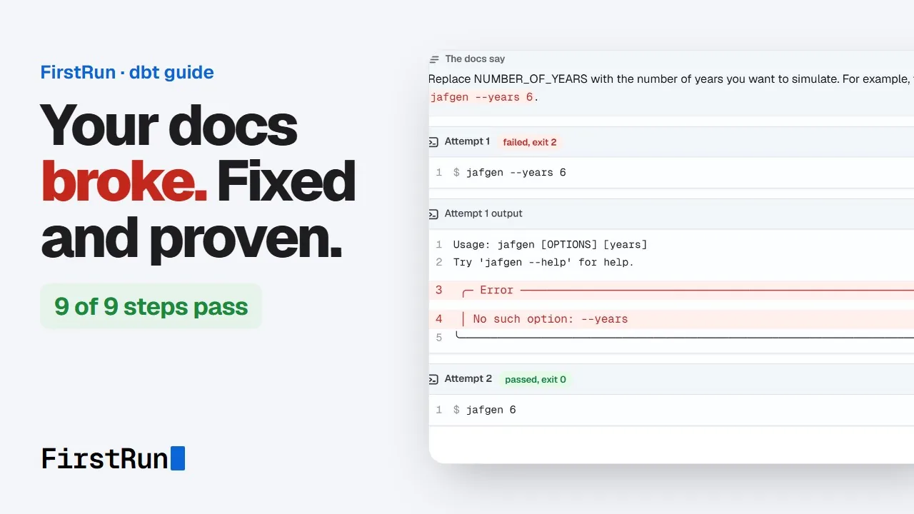</a><br><sub><b>The film (2:54)</b></sub></td>
<td align="center" width="20%"><a href="https://www.youtube.com/watch?v=JJNWWhSV9pc">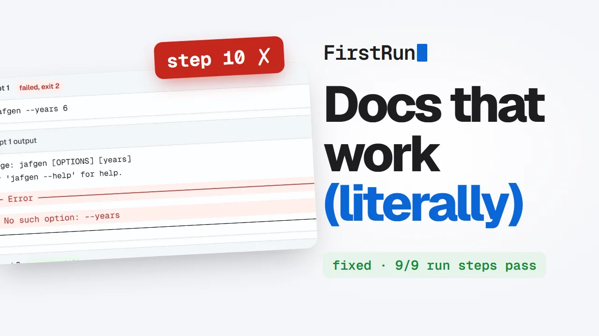</a><br><sub><b>DocTest demo (2:59)</b></sub></td>
<td align="center" width="20%"><a href="https://www.youtube.com/watch?v=2vZb6pZAF8Q">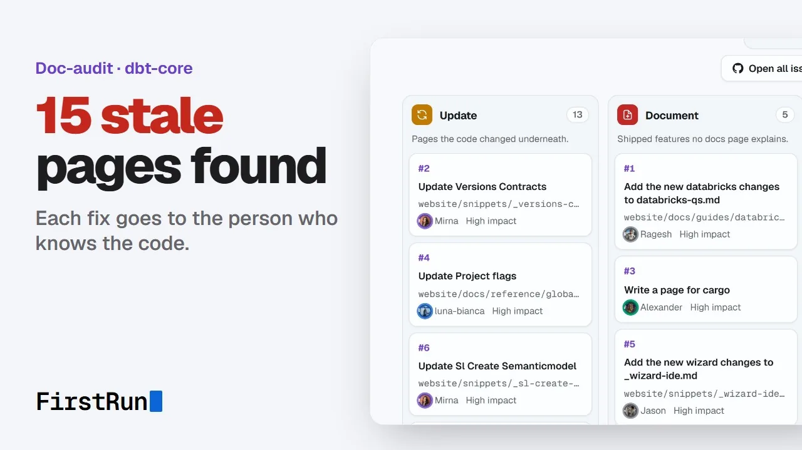</a><br><sub><b>DocAudit journey (1:56)</b></sub></td>
<td align="center" width="20%"><a href="https://www.youtube.com/watch?v=jKL8Ocb0Ki8">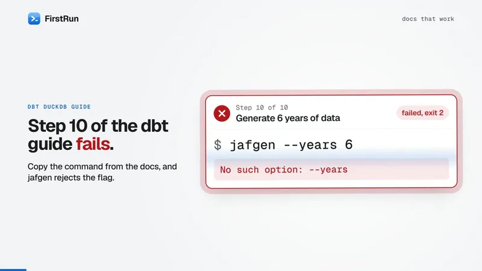</a><br><sub><b>Teaser (0:36)</b></sub></td>
<td align="center" width="20%"><a href="https://www.youtube.com/watch?v=zo94agwRAXc">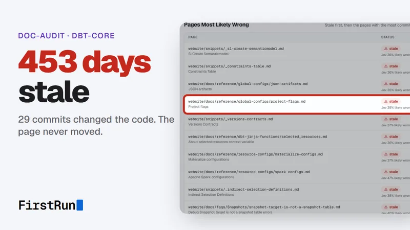</a><br><sub><b>DocAudit tour (0:57)</b></sub></td>
</tr>
</table>

<br>

<video src="docs/assets/firstrun-launch.mp4" poster="docs/assets/launch-poster.jpg" width="860" muted loop playsinline controls>
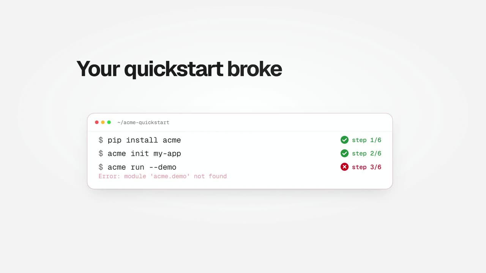
</video>

<sub>The 44-second launch film. The video does not play for you? [Open it on the site](https://firstrun.atharvashah.com/) or [download the MP4](docs/assets/firstrun-launch.mp4).</sub>

</div>

<br>

```bash
pip install git+https://github.com/HighnessAtharva/firstrun
firstrun https://docs.neatlogs.com/sdk/python
```

That command needs the setup in [Run Your First Check in 5 Minutes](#run-your-first-check-in-5-minutes). Replace the URL with your own quickstart.

## The Demo Video Runs 2 Minutes 54 Seconds and Covers All Three Tools

[Watch the demo video on YouTube (2:54)](https://www.youtube.com/watch?v=9xxgu_1bH-E). It covers the problem, Doc-test, Doc-audit, Agent Ready, neatlogs incidents, Entire and cfo.ai.

The [2:59 long cut](https://www.youtube.com/watch?v=JJNWWhSV9pc) runs FirstRun on the dbt guide at 0:12 and shows Bisect at 0:36. In the long cut, the neatlogs chapter starts at 1:07, Entire at 1:51 and cfo.ai at 2:19.

## Any Coding Agent Can Start From agent.md

Give Claude Code, Cursor, Codex or your own agent this one line:

```text
Read https://firstrun.atharvashah.com/agent.md and follow it.
```

- Open Agent Ready in the site navigation to copy the prompt. It adds an example task and shows the 6 steps your agent runs.
- [docs/agent.md](docs/agent.md) holds the preflight, the install, a recipe for each task, the JSON keys, the exit and error codes, and the safety rules.
- [llms.txt](https://firstrun.atharvashah.com/llms.txt) lists the agent files, and [llms-full.txt](https://firstrun.atharvashah.com/llms-full.txt) puts them in one file.
- `firstrun run`, `audit`, `receipt` and `prereqs` take `--json`, which prints one JSON object on stdout. `firstrun doctor --json` checks Python, git, Docker, the keys and the network, and prints no key value.
- [AGENTS.md](AGENTS.md) tells a coding agent how to build and test this repo.
- [skills/firstrun](skills/firstrun/SKILL.md) is an Agent Skill. Copy the folder into `.claude/skills/` in a project, or into `~/.claude/skills/` for every project, and Claude Code loads it.

## Break, Fix, Prove Takes 195 Seconds

<div align="center">
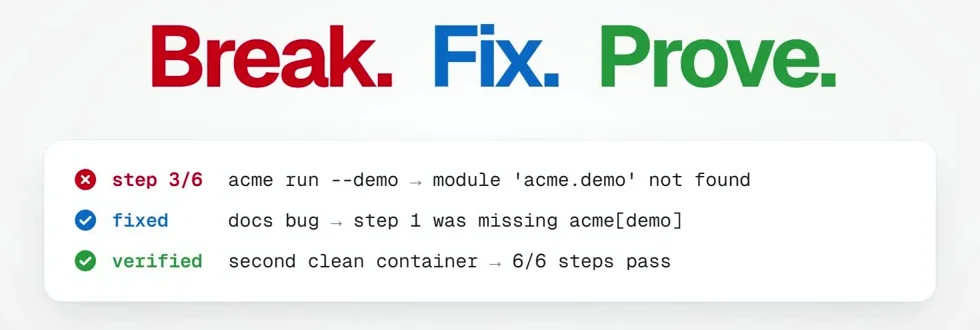
</div>

<table>
<tr>
<td width="33%" valign="top">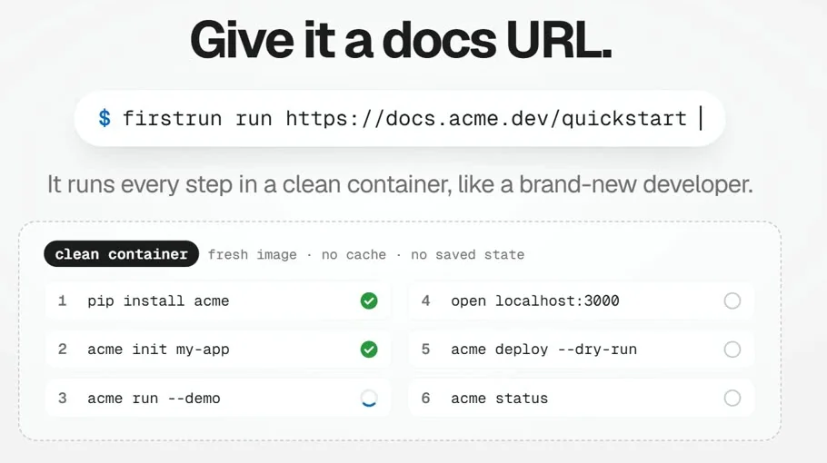<br><b>1. Read</b><br>FirstRun reads the page and plans one step per command.</td>
<td width="33%" valign="top">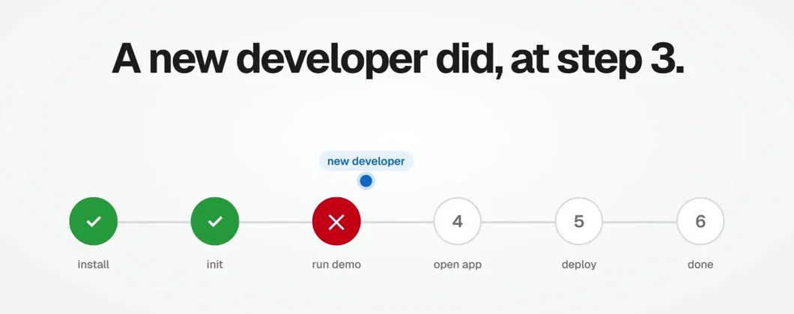<br><b>2. Run</b><br>Every step runs in a clean container, like a new developer. The first failure stops the run.</td>
<td width="33%" valign="top"><br><b>3. Prove</b><br>A fix is done only when a second clean container passes the whole quickstart.</td>
</tr>
</table>

The input below is a known-broken test fixture (`tests/fixtures/docs/broken_quickstart_FIXTURE.md`), not a real project's docs. Step 3 pins an old chromadb that cannot install on Python 3.11.

```text
Step 3 of 4: pip install chromadb==0.3
ERROR: No matching distribution found for numpy~=1.21.6

Cause:    docs_bug (source: jev)
Patch:    step 3 -> pip install chromadb
Verified: 4/4 steps passed in a fresh container
Time to first success: 195 s
```

FirstRun writes `report.md`, `patch.diff` and `pr_body.md` into the run folder. The patch is one line.

<a id="version-2-finishes-3-of-4-quickstarts-and-recovers-3-failed-steps"></a>
<a id="before-and-after-finished-quickstarts-went-from-2-of-4-to-3-of-4"></a>

## Before and After: v1 Versus v2 on the Same 4 Quickstarts

v1 ran with recovery off. v2 ran after the neatlogs planner fix ([3ca6f11](https://github.com/HighnessAtharva/firstrun/commit/3ca6f118ecb0a8915315eea27b5588dd8a7c6299)), with recovery and verification on. The same 4 targets ran both times, one run each. Every number comes from the neatlogs traces in [evidence/before_after_traces.json](evidence/before_after_traces.json), and [evidence/neatlogs.md](evidence/neatlogs.md) pairs the trace IDs. Cost is the Sonnet 5.5 list price and is not billed, because the runs use a subscription token.

| Target | v1 outcome (recovery off) | v1 trace | v2 outcome (fix, recovery, verify) | v2 trace |
|---|---|---|---|---|
| neatlogs Python SDK | passed 3/3 | `fccdbad9a9c6177b90112911fe485bd6` | passed 3/3 | `495d510fd6da5546dbc6ab6e52bcee68` |
| Entire CLI install | failed at step 1, `curl: command not found` | `10c44df9626c19f5ac801f1c6d84610e` | verified 4/4 after 2 fixes, one of them a real docs fix | `5520c5cff5e0ea61f130eced082b20c4` |
| Chroma getting started | passed 3/3 | `66ec093b00333fa221fade5d2fc5f55f` | passed 2/2 | `f63d2b842c2257ae8c340f6ce44e3848` |
| OpenAI v0 README (fixture, Wayback 2023-08-02) | failed at step 6, `openai: command not found` | `b98b419e286acf436083febdb5217cf9` | pinned `openai==0.28.1`, then stopped honestly: the example needs an OpenAI key | `78e538e63a65c5d00d0281effa119567` |
| **Finished (passed or verified)** | **2 of 4** | | **3 of 4** | |

| Target | Cost v1 | Cost v2 | Time v1 | Time v2 | Tool calls v1 | Tool calls v2 |
|---|---|---|---|---|---|---|
| neatlogs Python SDK | $0.0397 | $0.0529 | 118.9 s | 99.2 s | 4 | 4 |
| Entire CLI install | $0.0170 | $0.0095 | 27.6 s | 416.8 s | 2 | 12 |
| Chroma getting started | $0.0217 | $0.0019 | 272.9 s | 201.2 s | 4 | 3 |
| OpenAI v0 README | $0.0266 | $0.0157 | 94.4 s | 86.2 s | 7 | 5 |
| **Mean** | **$0.0262** | **$0.0200** | **128.4 s** | **200.8 s** | **4.25** | **6.0** |

Across the 4 runs, v2 recovered 3 failed steps against 0 in v1, and proved 1 fix in a fresh container against 0.

**v2 is slower, and one run explains it.** The mean time rose by 72.4 s. The Entire install took 27.6 s in v1 because it stopped at step 1. In v2 it recovered the step, fixed `PATH`, and then ran all 4 steps again in a fresh container, which took 416.8 s and 12 tool calls. The other 3 targets averaged 162.1 s in v1 and 128.9 s in v2. A verified fix costs a second full run, and that is the price of the proof. Four targets with one run each is a small sample.

The six mistakes the agent made in v1:

1. The plan changes between runs. The same neatlogs page gave 4 steps, then 3 steps, 5 minutes later.
2. The planner invents steps. It added `command -v entire` and `test -f first_trace.py`, which the docs never say.
3. The planner writes placeholder steps. Chroma step 2 is `true`.
4. A fake secret passes as a step. `export OPENAI_API_KEY='sk-...'` exits 0.
5. The planner skips the steps that matter, because they need a key.
6. 9 of 16 steps check only the exit code.

## The Business Plan Prices 3 Tiers and Ends Month 18 With $16,685 in Cash

A 70% margin floor turns the measured cost per run into a cap per tier. The plan is [business/BUSINESS_PLAN.md](business/BUSINESS_PLAN.md), the numbers are in [business/unit_economics.json](business/unit_economics.json), and the public model is [cfo.ai/s/_u5lbrHIl9KX_JQE](https://cfo.ai/s/_u5lbrHIl9KX_JQE).

| Tier | Price | Runs a month | Cap per run | Margin at mean cost | Margin at p95 cost |
|---|---|---|---|---|---|
| Free | $0 | 4 | $0.01355 | no revenue | no revenue |
| Team | $49 a month | 300 | $0.04697 | 87.8% | 66.4% |
| Scale | $299 a month | 3,000 | $0.02787 | 80.1% | 44.9% |

- **Cost per run:** the mean is $0.01782 over 88 neatlogs traces, and the p95 is $0.05286 (trace `495d510fd6da5546dbc6ab6e52bcee68`). Compute adds $0.00203. These are list prices, not billed.
- **Revenue and cash at month 18:** Base ends at $2,069 MRR and $16,685 cash. Growth ends at $5,427 MRR and $44,674 cash. Cash starts at $5,000 on 2026-11-01. Source: [docs/data/cfo-model.json](docs/data/cfo-model.json).
- **Payback:** in Base, cash is back above the $5,000 start in month 3 ($5,042, 2027-01). In Growth it happens in month 1 ($5,097).
- **Runway:** under the old fixed $0.50 cap, cash goes negative in month 14 (2027-12, -$1,288) and ends month 18 at -$12,212. Base and Growth never run out.
- **Limit:** no customer has paid yet, so every customer count in the model is an assumption.

## Seven Teams Get a Different Job Out of the Same Engine

| # | You are | The problem | Run this | You get |
|---|---|---|---|---|
| **1** | A DevRel or docs lead | Nobody tests the quickstart after launch day | `firstrun <url>` | A pass or a verified fix, with a PR draft |
| **2** | A release manager | A new release of your package broke the docs and you do not know which one | `firstrun bisect <run> --package <pkg>` | The last good and first bad release |
| **3** | A technical writer | The docs assume tools the reader does not have | `firstrun prereqs <run>` | A Prerequisites block, proven in a clean container |
| **4** | An open-source contributor | You want a first PR that a maintainer merges | `firstrun pr <run>` | The `gh` commands for the docs PR, source check included |
| **5** | An engineer picking a tool | You want to know if the vendor's quickstart works before you commit | `firstrun <url>` | A time to first success and the first step that breaks |
| **6** | A coding agent | You need a loop that checks its own docs work | `firstrun run --resume <id>` | State after every step and a model-free verify |
| **7** | A head of docs | Hundreds of pages, and the code moved under some of them | `firstrun audit owner/repo` | Stale pages with the commits behind them, features with no docs, proposal cards and drafted release notes |

<details open>
<summary><b>7. Which docs did the product outgrow?</b> Audit the whole docs set from the git history.</summary>

```bash
firstrun audit fastapi/typer
```

```bash
firstrun audit dbt-labs/dbt-core --docs-repo dbt-labs/docs.getdbt.com
```

One blobless clone gives the whole history. The audit then works offline and costs $0 in model calls. Jev sorts commits with no conventional prefix when `TYPESAFE_API_KEY` is set, and every audit is one neatlogs trace.

- **Oldest first.** Every page, ranked by the date of its last edit.
- **Stale or quiet.** A page is stale when product commits on its topic landed after its last edit, and the report names those commits. An old page that nothing changed under is quiet, so the team can leave it alone.
- **Features with no docs.** Each user-facing commit in 120 days is checked against the docs text. A flag or name that no page mentions becomes a "Document this" card.
- **Proposal cards.** Document this, refresh this page, feature this, and automate the release notes.
- **What to ship next.** One ranked list of up to 30 tasks. Each task has a score from 0 to 100, an effort of S, M or L, and one sentence that cites the commits and dates behind it. The score adds reader impact, urgency, evidence, whether Jev checked it, and ease, with fixed weights you can recompute by hand.
- **Who works on what.** A map of the people who made the last 12 months of commits and the parts of the code they work on. Each task suggests an owner and gives the reason, such as "Maya made 14 of the last 20 commits to docs/use-cases/".
- **Drafts.** Release notes for the newest stable tag and up to 3 product highlights, written from commit subjects and pull request numbers.

`firstrun audit-issue` turns the newest audit into `issue.md`, one checkbox for each of the top 10 tasks, and prints the `gh issue create` command. It opens nothing on its own. A suggested owner appears as a name and a login without the @, so nobody gets a GitHub notification.

**Team map and privacy.** The map reads public commits: author names, GitHub logins and avatars, commit counts and dates. It never shows an email, raw or hashed. Emails stay in memory to join one person's commits, and a sanitizer drops any email before a board is written.

Bots are left out. A commit counts by the files it changed, never by lines, and a commit 90 days old counts half. Every owner is a suggestion, not an assignment. Four opt-outs turn the map off or hide one person:

- Run `firstrun audit --no-team`, or set `FIRSTRUN_TEAM=0`.
- A repo owner adds `team: false` to `.github/firstrun.yml` or `.firstrun.yml`.
- An audit request ticks "Leave out the team map" on the issue form. `firstrun audit-submit` leaves the map out unless you add `--with-team`.
- A person adds `sha256:<hex>` of their lowercase login or name to `hidden` in [`docs/audits/team-optout.json`](docs/audits/team-optout.json). Their work moves into "Everyone else" and no task suggests them.

To audit every week, copy [`examples/github-action/firstrun-audit.yml`](examples/github-action/firstrun-audit.yml) into `.github/workflows/`. Each Monday it audits the repo and updates one issue labeled `firstrun-audit`, so the docs team gets a fresh work list without anyone running a command.

`--docs-repo` reads the docs from a second repo when the docs site lives apart from the code. Inside this repo, each audit is published to `docs/audits/` and opens at [audit.html](https://1run.netlify.app/audit.html).

</details>

<details open>
<summary><b>1. Does my quickstart work today?</b> Run it every night.</summary>

<br>

A DevRel team ships a quickstart once and a dependency moves the week after. The first person to find the break is a new user, and most new users leave instead of filing a bug.

```bash
firstrun https://docs.example.com/quickstart
```

A clean pass ends as `passed`. A break ends as `verified` once a second container proves the fix. The nightly check costs $0.0178 per run on average over 88 runs, measured by neatlogs at list price ([business/unit_economics.json](business/unit_economics.json)).

</details>

<details>
<summary><b>2. Which release broke it, and when?</b> Docs Bisect names the package version.</summary>

<br>

```bash
firstrun bisect <run> --package jafgen
```

FirstRun binary-searches the package's releases, one fresh container per probe, with the version pinned through `PIP_CONSTRAINT`. It replays stored commands, so a bisect makes no model calls.

**Real result:** the dbt DuckDB guide never worked in a clean environment. Its step `jafgen --years 6` passes on jafgen 0.3.1 (2023-01-17) and fails on 0.4.6 (2024-04-07). PyPI has no release between them. The guide merged on 2025-03-14, 11 months after `--years` was gone. 5 probes found it.

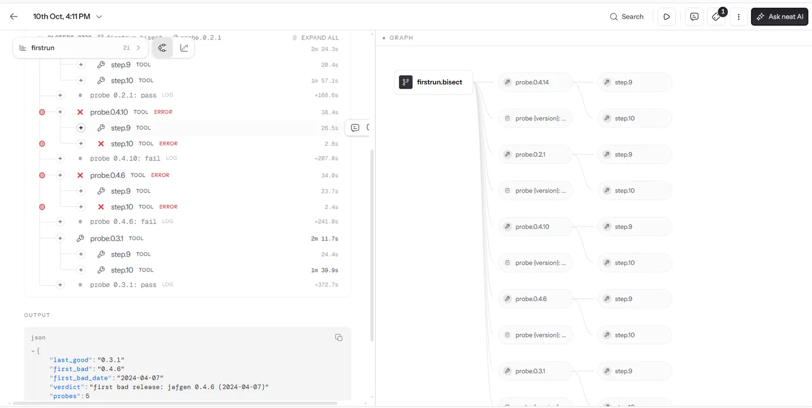

</details>

<details>
<summary><b>3. What does it silently assume?</b> Prerequisite Proof writes the missing block.</summary>

<br>

```bash
firstrun prereqs <run>
```

FirstRun turns the container fixes of a run into a Prerequisites block. Then it proves the block. A fresh container with only those items runs the docs as written.

| Quickstart | The docs assume | Proof in a clean `python:3.11-slim` |
|---|---|---|
| AccuKnox knoxctl | curl, ca-certificates, gnupg, sudo | proven, 5/5 steps |
| MkDocs | curl | proven, 9/9 steps |
| Entire install | curl, git, `~/.local/bin` on `PATH` | proven, 4/4 steps, git found in round 2 |
| dbt + DuckDB | Python 3.12 or later, git | steps 1 to 9 pass on `python:3.12-slim`, step 10 is the jafgen docs bug |

</details>

<details>
<summary><b>4. Open the docs PR.</b> A verified fix becomes an upstream pull request.</summary>

<br>

```bash
firstrun pr <run>
```

FirstRun prints the `gh` commands and a PR body. Every draft gets a source check first, because a docs note can look like a docs bug. FirstRun opened 4 real PRs this way. They are listed [below](#firstrun-found-4-real-docs-bugs-and-opened-4-upstream-prs).

</details>

<details>
<summary><b>5. Test a vendor before you adopt it.</b> Time to first success is the number.</summary>

<br>

Point FirstRun at any public quickstart. The report shows how long a new developer needs to reach a working result, and where they get stuck first.

</details>

<details>
<summary><b>6. Give your coding agent the loop.</b> Plan, run, recover, verify, with a trace.</summary>

<br>

The site hands you a prompt for Claude Code, Cursor or Codex. The agent installs FirstRun, checks Docker, runs your quickstart, proves the fix and opens the PR when you say yes. `state.json` is written after every step, so a run resumes with `firstrun run --resume RUN_ID`.

</details>

## Radar Picks the Quickstarts Worth a Run, and the Run Log Picks the Buyers

FirstRun spends model money on every run, so it should only run where a break is likely and someone will read the fix.

1. **Find.** Exa search returns candidate quickstart pages at no cost.
2. **Rank.** `scripts/radar.py` asks Jev 4 typed questions per page in one call: can it run unattended in a container, is a step likely to break, how many developers read it, and is it the official docs. Code multiplies the answers into one priority. No model reads the pages one by one.
3. **Run.** `firstrun run --targets targets-radar.txt --tag radar --tier team` runs the top pages in 3 parallel lanes under the plan-set cost cap. Every run is logged on the [runs page](https://1run.netlify.app/runs/).
4. **Sell.** `scripts/buyers.py` maps each docs site FirstRun ran on or audited to its company, enriches it through treg at $0.0018 a lookup, and asks Jev whether the company fits the $49 to $299 plan. The result is [business/buyers.md](business/buyers.md): companies FirstRun already has proof for, each linked to its replay. It holds company data only, with no people and no emails.

```bash
python scripts/radar.py --from-exa exa_results/*.txt --top 20
```

```bash
python scripts/buyers.py
```

## FirstRun Found 4 Real Docs Bugs and Opened 4 Upstream PRs

FirstRun ran five open-source quickstarts whose docs live in public repos. Every finding came from a verified run, where a second clean container passed with the fix.

<table>
<tr>
<td width="33%" valign="top"><a href="https://github.com/dbt-labs/docs.getdbt.com/pull/10149">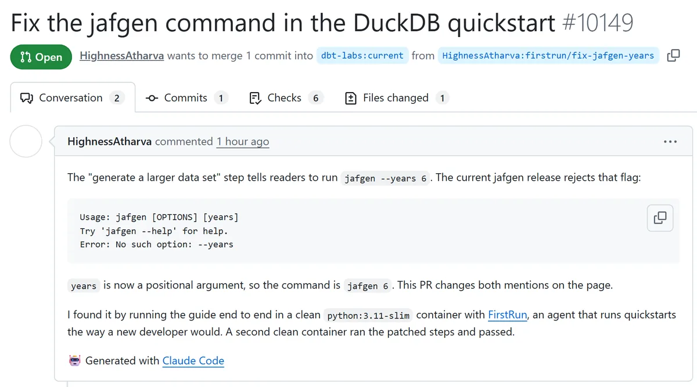</a><br><b>dbt-labs/docs.getdbt.com#10149</b><br>Fix the jafgen command in the DuckDB quickstart.</td>
<td width="33%" valign="top"><a href="https://github.com/dbt-labs/docs.getdbt.com/pull/10150">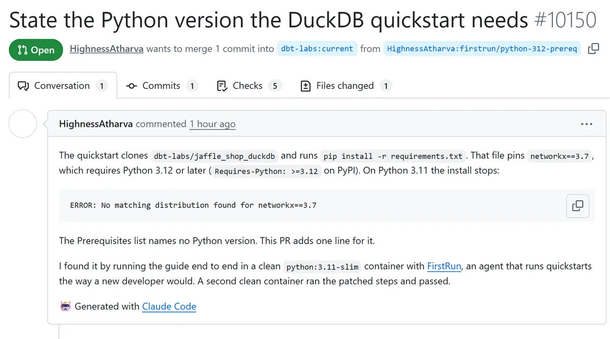</a><br><b>dbt-labs/docs.getdbt.com#10150</b><br>State the Python version the DuckDB quickstart needs.</td>
<td width="33%" valign="top"><a href="https://github.com/entireio/cli/pull/2724">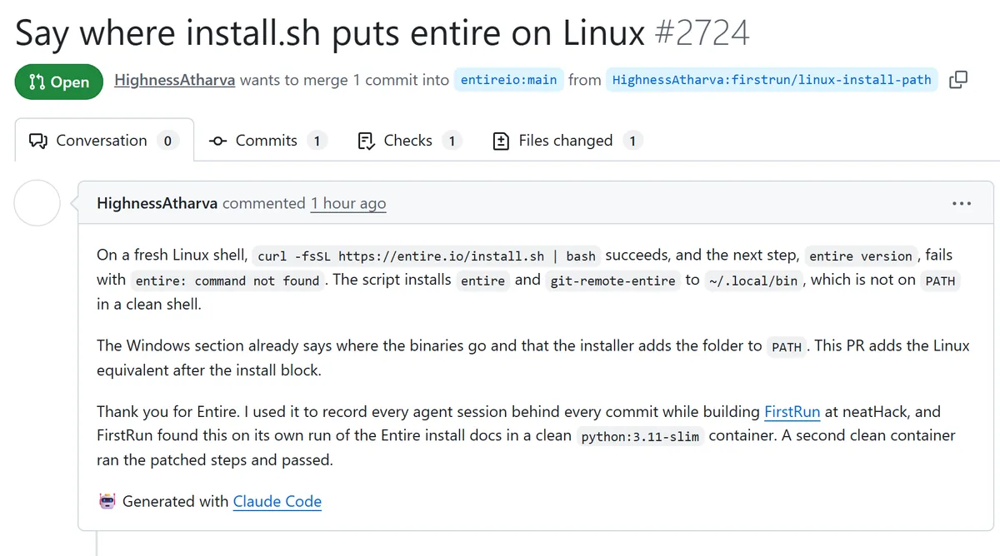</a><br><b>entireio/cli#2724</b><br>Say where install.sh puts entire on Linux.</td>
</tr>
</table>

| Quickstart | Result | What FirstRun found | Upstream | State on 2026-10-12 |
|---|---|---|---|---|
| [dbt Core with DuckDB](https://docs.getdbt.com/guides/duckdb) | verified 9/10 | `jafgen --years 6` fails because `years` is now positional | [dbt-labs/docs.getdbt.com#10149](https://github.com/dbt-labs/docs.getdbt.com/pull/10149) | open, review required |
| same guide | verified | the cloned repo pins `networkx==3.7`, which needs Python 3.12, and the guide names no version | [dbt-labs/docs.getdbt.com#10150](https://github.com/dbt-labs/docs.getdbt.com/pull/10150) | open, review required |
| [Entire CLI install](https://docs.entire.io/installation) | verified 4/4 | `install.sh` puts `entire` in `~/.local/bin`, which a clean shell lacks on `PATH` | [entireio/cli#2724](https://github.com/entireio/cli/pull/2724) | open, review required |
| [AccuKnox knoxctl](https://help.accuknox.com/knoxctl/) | verified 5/5 | the page names 0.9.0 as latest while the installer fetches 0.9.58, and the APT steps need `curl`, `gnupg` and `sudo` | [accuknox/help#671](https://github.com/accuknox/help/pull/671) | open, review required |
| [MkDocs getting started](https://www.mkdocs.org/getting-started/) | verified 9/10 | the docs commands work, the container needed `curl` | none needed | n/a |
| [Dagster quickstart](https://docs.dagster.io/getting-started/quickstart) | verified 10/10 | the docs already cover both gaps FirstRun hit: install `create-dagster` first, and pip 25.1 for `--group` | none needed | n/a |

On #10149, [a bisect comment](https://github.com/dbt-labs/docs.getdbt.com/pull/10149#issuecomment-6096827074) shows jafgen 0.4.6 dropped `--years` 11 months before the guide shipped. Each PR also carries a public replay of its run: [#10149](https://github.com/dbt-labs/docs.getdbt.com/pull/10149#issuecomment-6097945132), [#10150](https://github.com/dbt-labs/docs.getdbt.com/pull/10150#issuecomment-6097945350), [#2724](https://github.com/entireio/cli/pull/2724#issuecomment-6097945657), [#671](https://github.com/accuknox/help/pull/671#issuecomment-6097945911). The states above come from `gh pr view`, and none is merged yet. Replay any run in the browser at [firstrun.atharvashah.com](https://firstrun.atharvashah.com/run.html).

## Built for #neatHack With Three Required Tools

<div align="center">

[](https://neatlogs.com/hackathon)

**A huge thanks to the [neatlogs](https://neatlogs.com) team for #neatHack.**
One weekend, one solo build, and three tools that each did one job.
No FirstRun code existed before kickoff on 2026-10-10 at 12:30 PM IST.

</div>

<table>
<tr>
<td width="33%" valign="top" align="center">
<a href="https://neatlogs.com"></a>
<h3>neatlogs</h3>
<b>Traces every run.</b><br>
The planner, executor and verifier show up as spans, so a bad run has a cause you can read.
</td>
<td width="33%" valign="top" align="center">
<a href="https://entire.io"></a>
<h3>Entire</h3>
<b>Records every session.</b><br>
Each agent commit carries the Claude Code session that wrote it, so its lines trace to a prompt.
</td>
<td width="33%" valign="top" align="center">
<a href="https://cfo.ai"></a>
<h3>cfo.ai</h3>
<b>Turns cost into a plan.</b><br>
The measured cost per run from neatlogs goes into the pricing model.
</td>
</tr>
</table>

### The Three Tools at a Glance

| | neatlogs | Entire | cfo.ai |
|---|---|---|---|
| **Architecture** | One `firstrun.run` trace wraps reading, planning, every step and verification. | Checkpoints, Graph, Brain and Trails, enabled before commit 1 (Entire CLI 0.11.4). | `business/drivers.csv` from neatlogs traces goes to Ari over the `cfoai` MCP server, which builds the public model. |
| **Implementation** | neatlogs Python SDK 1.4.26 in `src/firstrun/tracing.py`, plus 2 detections, 3 alerts and an AI evaluator. | `entire enable --agent claude-code`, a checkpoint trailer on each agent commit and 6 Trail runners. | `firstrun econ` reads 88 traces and writes `drivers.csv`. `firstrun run --tier NAME` applies the cap. |
| **Runtime** | Every run and audit exports one trace. | Each agent commit records its session. An Entire merge gate blocks on a high finding. | The executor and the recovery agent check the tier cap in the `budget` GUARDRAIL span. |
| **Reasoning** | The "planner invented a step" detection flagged 3 planner spans in v1. Investigate traced them to the planner prompt. | Entire runners reviewed every layer on Trails 3 to 7 and found real bugs, such as a secret retry loop. | The old $0.50 cap was 30 times the mean run of $0.0178, so the plan sets a cap for each tier. |
| **Result** | Finished quickstarts went from 2 of 4 to 3 of 4. Cost per run went from $0.0262 to $0.0200. | 93 of 155 non-merge commits on main at `ac05fd6` carry a checkpoint. The Entire judge ranked the repo 3.93 of 5. | The old cap runs out of cash in month 14. Base ends month 18 at $16,685. |
| **Proof** | [evidence/neatlogs.md](evidence/neatlogs.md) | [evidence/entire.md](evidence/entire.md) | [public model](https://cfo.ai/s/_u5lbrHIl9KX_JQE), [business/BUSINESS_PLAN.md](business/BUSINESS_PLAN.md) |

### neatlogs Shows What the Agent Did

Each run is one `firstrun.run` trace. The span kinds are WORKFLOW, AGENT, TOOL and GUARDRAIL. Claude calls appear as typed LLM spans.

<table>
<tr>
<td width="50%" valign="top">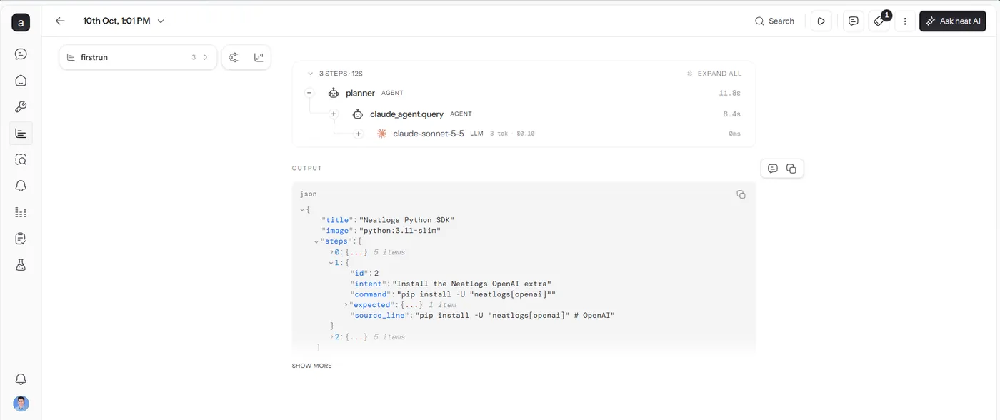<br><b>One trace per run.</b> Reading, planning, every step and verification sit under one root span.</td>
<td width="50%" valign="top">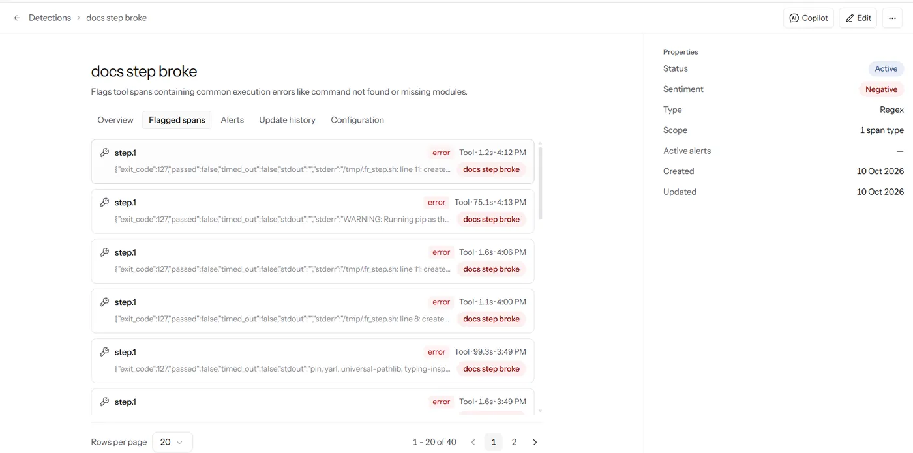<br><b>A custom detection.</b> "Docs step broke" flags failed tool spans. 78 flagged on Oct 10 and 11, from a baseline of 0 ([evidence/neatlogs.md](evidence/neatlogs.md)).</td>
</tr>
<tr>
<td width="50%" valign="top">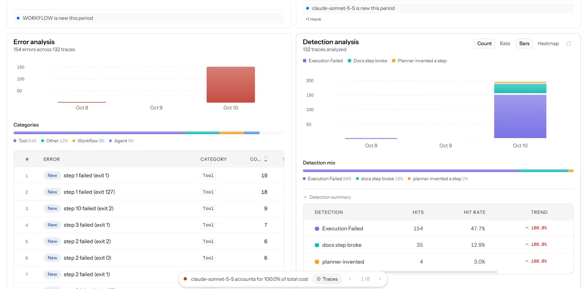<br><b>Detection analysis.</b> 132 traces, 154 errors. "Docs step broke" hit 35 times, 12.9%.</td>
<td width="50%" valign="top">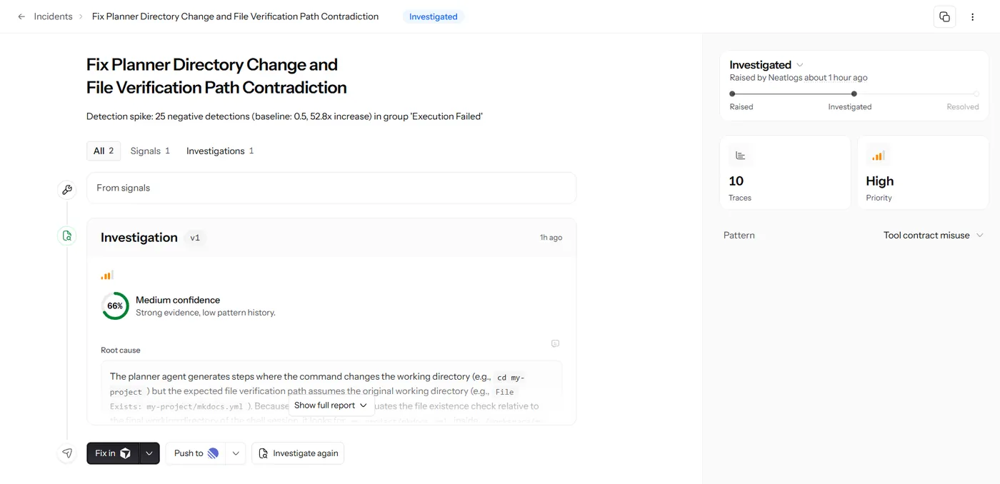<br><b>Investigate.</b> A 52.8x spike in Execution Failed opened a root cause with a confidence score.</td>
</tr>
<tr>
<td width="50%" valign="top">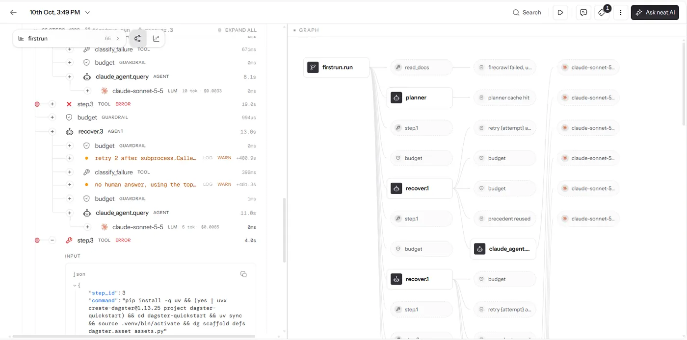<br><b>Recovery spans.</b> Classify, search, patch and retry show as `recover.N` spans.</td>
<td width="50%" valign="top">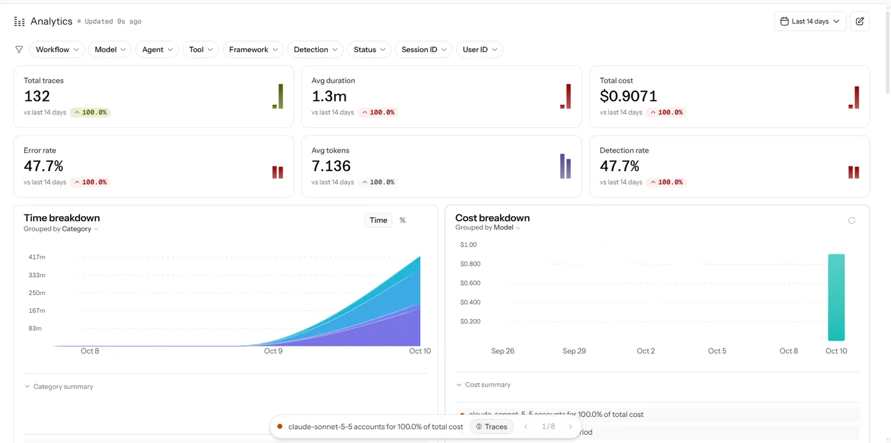<br><b>Analytics.</b> 132 traces and $0.9071 total cost, in one view.</td>
</tr>
</table>

Two detections run on the traces: "docs step broke" and "planner invented a step". The second one flagged 3 planner spans in v1. Investigate traced them to the planner prompt and proposed a stricter one ([evidence/neatlogs-investigation.md](evidence/neatlogs-investigation.md)). A Claude Code session read the detection and its trend over the neatlogs MCP server and applied the fix in commit [3ca6f11](https://github.com/HighnessAtharva/firstrun/commit/3ca6f118ecb0a8915315eea27b5588dd8a7c6299). The fix adds code guards that drop invented, placeholder and fake-secret steps.

The integration check read 3 real runs back from persisted traces. See [docs/neatlogs-integration.md](docs/neatlogs-integration.md).

### Entire Records How the Build Happened

<table>
<tr>
<td width="33%" valign="top">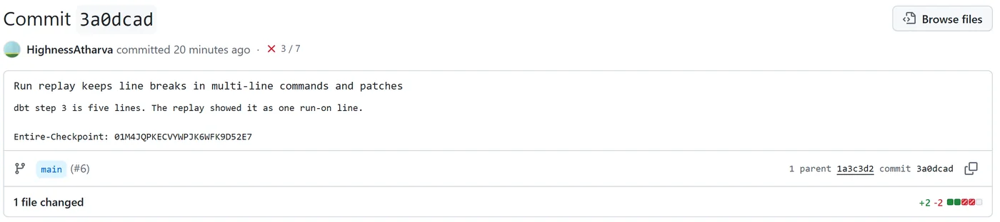<br><b>A checkpoint on each agent commit.</b> The commit maps back to the session that wrote it.</td>
<td width="33%" valign="top">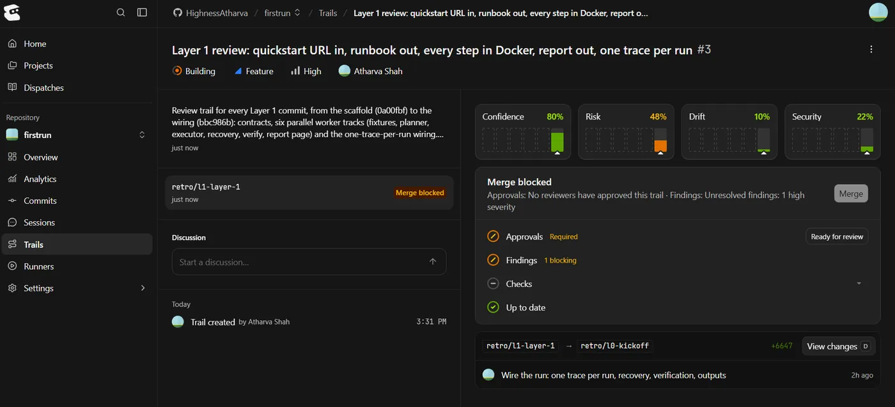<br><b>A merge gate.</b> The merge stays blocked while a high finding is open.</td>
<td width="33%" valign="top">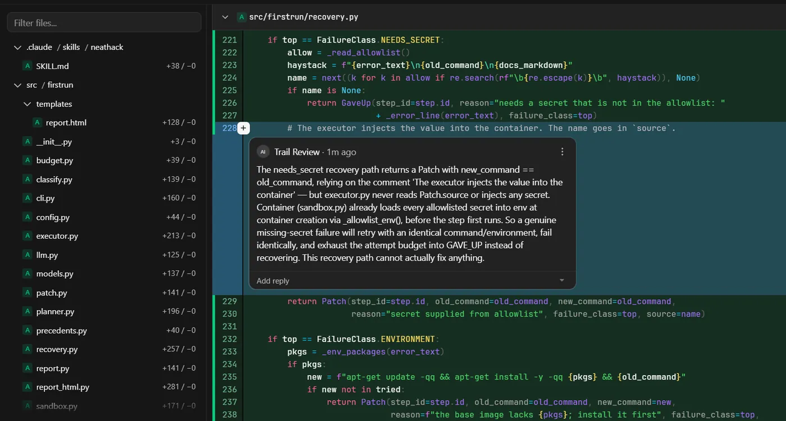<br><b>Inline review.</b> The finding sits on the line in <code>src/firstrun/recovery.py</code>.</td>
</tr>
</table>

- **Checkpoints:** 93 of 155 non-merge commits on main at `ac05fd6` carry an `Entire-Checkpoint:` trailer, counted with `git log --no-merges --grep='^Entire-Checkpoint:'` on 2026-10-12. Up to `f5d73eb` the count was 91 of 132, and the 41 without are the 4 setup commits before the first agent session and site commits from 2026-10-10 and 2026-10-11. On many of those the Entire commit hook hung and was stopped so the commit could land. Merge commits carry none, because Entire's hook skips merges. The neatlogs fix commit shows the full agent session behind it: [checkpoint 01M4JGJ6NTE7YNB9Z0YW5FYVHN](https://entire.io/gh/HighnessAtharva/firstrun/commit/3ca6f118ecb0a8915315eea27b5588dd8a7c6299).
- **Trail reviews:** Entire runners reviewed every layer on Trails 3 to 7. They raised 2 real bugs on Layer 1, a secret retry loop and a Windows-only Docker default, both fixed in [e2aacb7](https://github.com/HighnessAtharva/firstrun/commit/e2aacb7).
- **Trails:** [Trail 3](https://entire.io/gh/HighnessAtharva/firstrun/trails/3) covers Layer 1, and each later layer has its own Trail, listed in [evidence/entire.md](evidence/entire.md). Trail pages need an entire.io login. The commit and session pages open without one.
- **Graph:** the build agents searched the repo through the graph. `entire graph stats` counted 10 graph calls and about 56,254 tokens saved ([evidence/entire.md](evidence/entire.md)).
- **Brain:** it holds 16 durable facts, such as why recovery stops at 3 attempts. A refresh from a clean `main` covered 38 sessions, 319 files, 6,770 symbols and 16,549 relations ([evidence/entire.md](evidence/entire.md), [graph.ndjson](evidence/graph.ndjson)).

### cfo.ai Prices the Nightly Check

<table>
<tr>
<td width="45%" valign="top">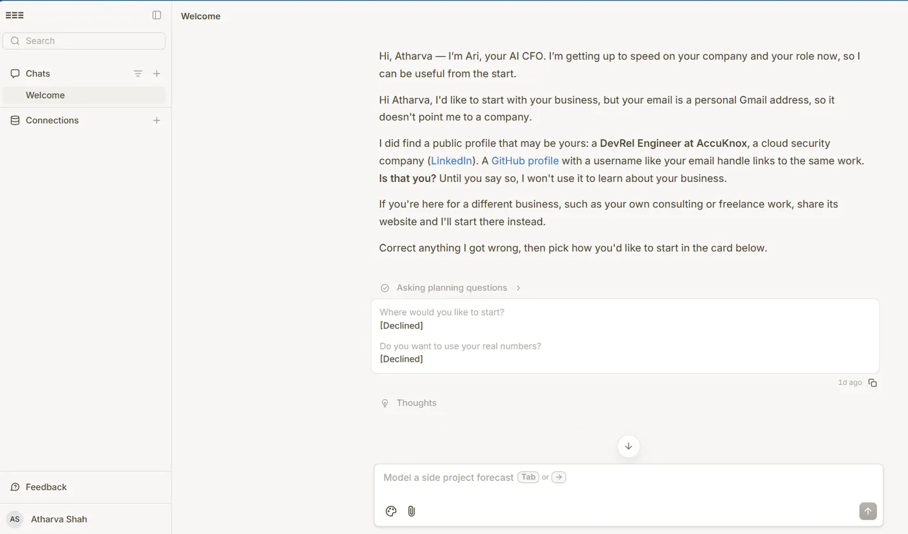<br><sub>Ari, the cfo.ai agent, on day one.</sub></td>
<td valign="top">

The business plan sets the agent's spending limit. `firstrun econ` reads 88 neatlogs traces and writes [business/drivers.csv](business/drivers.csv) for cfo.ai. The mean run costs $0.0178, and the p95 run costs $0.0529. A 70% margin floor turns those costs into a cap per tier, and `firstrun run --tier scale` stops any run that spends past the cap.

| Tier | Price | Quickstarts | Cap per run | Runs over the cap |
|---|---|---|---|---|
| Free | $0 | 1, weekly | $0.0135 | 50.0% |
| Team | $49 a month | 10, nightly | $0.0470 | 9.1% |
| Scale | $299 a month | 100, nightly, with PRs, Bisect and Prerequisite Proof | $0.0279 | 26.1% |

Prices, costs, revenue, cash and runway are in [the business plan section above](#the-business-plan-prices-3-tiers-and-ends-month-18-with-16685-in-cash). The old fixed cap of $0.50 let one bad month cost a Scale customer's fee five times over, and [business/BUSINESS_PLAN.md](business/BUSINESS_PLAN.md) holds the Scale fix and every assumption.

The [plan page](https://firstrun.atharvashah.com/plan/) shows the caps, the measured cost spread and the cash per Scenario. Every doc-test run is tagged against the caps. A neatlogs alert fires when the p95 cost passes the Scale cap plus 25% ($0.035), and `scripts/neatlogs_issues.py` mirrors each detection and alert as a GitHub issue labeled [`neatlogs`](https://github.com/HighnessAtharva/firstrun/issues?q=label%3Aneatlogs).

</td>
</tr>
</table>

### Every Run and Audit Ends With a Receipt

A receipt turns one unit of agent work into a priced, capped, verified and checkable record. [A sample bill](docs/receipts/FR-20261010-091740-help-accuknox-com.html) for the AccuKnox knoxctl run shows the parts:

- **Priced.** Model usage $0.0453 plus compute $0.0020 gives a total of $0.0473. The prices are list prices, not billed.
- **Capped.** Bars show the run against each tier's cap from the cfo.ai plan. The model cost is 96.4% of the Team cap and over the Scale and Free caps.
- **Proven.** A stamp says whether a second clean container reran the patched steps with no model calls. A run that ended any other way says "Not verified".
- **Checkable.** The receipt carries its own hash and the SHA-256 of `state.json`, `runbook.json` and `report.md`.

```bash
firstrun receipt RUN_ID --html
```

```bash
firstrun receipt --check runs/RUN_ID/receipt.json
```

`--check` fails when the receipt or one of its evidence files changed after it was issued. `firstrun receipt --all-published` writes a receipt for every run and audit on the site, and publishing a run or an audit writes its receipt too. The Doc-test and Doc-audit pages show a "View receipt" button with the amount on every row.

A doc audit prices its Jev reads at TypeSafe's list price of $0.042 per million input tokens, and the clone and the analysis cost nothing. New audits record their Jev calls and tokens. The 7 audits published before cost tracking show an estimate, marked "est.", measured by re-running each one with [`scripts/audit_cost_estimates.py`](scripts/audit_cost_estimates.py). The estimates run from $0.0001 (fastapi/typer) to $0.0055 (dbt-core).

## The Build Happened in Public on X

Every step is a post on [@cultist_dev](https://x.com/cultist_dev). The five below tell the story in order.

<table>
<tr>
<td width="50%" valign="top">

**kickoff**<br>
> #neatHack kickoff, 12:30 IST. FirstRun code before kickoff: 0 lines. neatlogs doctor probe: 7/7 PASS. Solo build. Submission opens Monday, 7 PM IST.

[Read on X](https://twitter.com/cultist_dev/status/2108815318541844954)

</td>
<td width="50%" valign="top">

**day one**<br>
> #neatHack, day one. all three required tools are up. Entire: trail #1 created. neatlogs: first agent trace, 3 steps, 12s. cfo.ai: Ari read my public profile.

[Read on X](https://twitter.com/cultist_dev/status/2108826005854937357)

</td>
</tr>
<tr>
<td width="50%" valign="top">

**the pitch**<br>
> your quickstart is the only part of your product tested by people who leave instead of filing a bug. so for #neatHack i'm building FirstRun. break. fix. prove.

[Watch on X](https://twitter.com/cultist_dev/status/2108828983194206308)

</td>
<td width="50%" valign="top">

**the plan**<br>
> a quickstart breaks the way an agent breaks. quietly. so the plan for this weekend: every FirstRun run becomes a trace in @neatlogs.

[Read on X](https://twitter.com/cultist_dev/status/2108856505566921210)

</td>
</tr>
<tr>
<td colspan="2" valign="top">

**the first catch**<br>
> my neatlogs hackathon project has already caught doc issues for a chroma (24K+ github stars). chromadb's deprecated-config error sends you to its own migration guide. that page returns 404.

[Read on X](https://twitter.com/cultist_dev/status/2108788557670125946)

</td>
</tr>
</table>

## Run Your First Check in 5 Minutes

You need:

- Python 3.11 or newer.
- Git. `pip install git+https://...` clones the repo, so it fails without git.
- Docker. On Windows, run Docker inside WSL with the `Ubuntu-22.04` distro.
- A Claude subscription token in `CLAUDE_CODE_OAUTH_TOKEN`. Create one with `claude setup-token`.
- Optional: `NEATLOGS_API_KEY` for traces.
- Optional: `TYPESAFE_API_KEY` for Jev. Without it, Claude classifies the failure.

Install:

```bash
pip install git+https://github.com/HighnessAtharva/firstrun
```

FirstRun reads keys from `.env` in the folder you run it from. To use another file, set `FIRSTRUN_ENV_FILE`:

```bash
export FIRSTRUN_ENV_FILE=/path/to/your/.env
```

FirstRun uses `docker` from your `PATH`. On Windows without it, FirstRun calls Docker inside WSL with `wsl -d Ubuntu-22.04 docker`. Set `FIRSTRUN_DOCKER` to use another command.

Run it on a quickstart URL. This one passed 3 of 3 steps in the neatlogs v1 and v2 runs:

```bash
firstrun https://docs.neatlogs.com/sdk/python
```

Check your setup first with `firstrun doctor`. It prints one line for each tool and key, and never prints a key value.

A URL tested in the last 24 hours returns the cached result. Add `--fresh` to run it again.

Read the result in `runs/<run-id>/report.md`. Build the HTML report with:

```bash
firstrun report --html
```

Run it inside a clone of this repo and every run is logged for the public site. FirstRun writes the replay to `docs/runs/` and adds a row to `docs/runs/index.json`. Commit those files and the run appears on the [runs page](https://1run.netlify.app/runs/). Rebuild the log from the `runs/` folder with:

```bash
firstrun publish --all
```

The offline test suite needs no network, Docker or keys. The tests ship with the repo, not with the pip package, so clone it first:

```bash
git clone https://github.com/HighnessAtharva/firstrun
```

```bash
cd firstrun && pip install -e ".[dev]" && pytest -q
```

FirstRun ran this section on itself in a clean `python:3.11-slim` container. The install failed until git was present, which is why git is listed above. The run step then stopped with the missing-token message, because a clean container has no Claude token or Docker.

## One Trace Follows the Docs Page From Read to Verified Fix

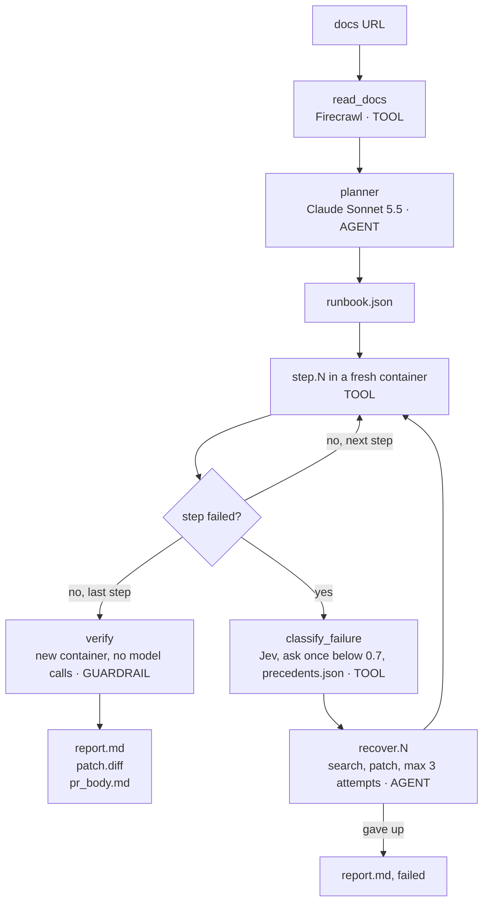

A `budget` GUARDRAIL span runs before every recovery. The root span `firstrun.run` is a WORKFLOW span that holds the whole tree. [docs/architecture.md](docs/architecture.md) lists the states, the failure classes, the budgets and every span.

## Each of the 8 Focus Areas Has a Feature You Can Open

| Focus area | Feature | Where you see it |
|---|---|---|
| Planning | The planner turns the docs page into a runbook | `runbook.json`, the `planner` span |
| Tool use | Firecrawl reads, Docker runs, Jev classifies | One TOOL span per call |
| State | `state.json` is written after every step | `firstrun run --resume RUN_ID` |
| Context | The planner reads only the quickstart page | `read_docs` span input |
| Execution | One fresh container per run | `step.N` spans with exit codes |
| Recovery | Classify, search, patch, retry up to 3 times | `recover.N` span |
| Verification | A model-free re-run in a new container | `verify` span, status `verified` |
| Iteration | v1 traces, detections, a fix, v2 traces | The results table below |

## A Quickstart Step Failed, and FirstRun Fixed It and Proved the Fix

The dbt DuckDB guide ran on 2026-10-10 as a 10-step plan. Step 1 failed because the container had no git, step 3 hit a networkx pin that needs Python 3.12, which the guide never states, and step 10 used a removed flag (`jafgen --years 6`). Steps 3 and 10 are the two docs bugs. FirstRun classed each failure, patched the command and retried it. Step 7, `dbt docs serve`, starts a web server, so FirstRun skipped it and said why. A fresh container then passed 9 of 9 runnable steps with no model calls. The run record is [docs/examples/dbt.txt](docs/examples/dbt.txt), a share code in the format of [docs/share-format.md](docs/share-format.md). [Open the dbt run on the site](https://firstrun.atharvashah.com/doc-test/#ex=dbt).

1. **The step fails.** `jafgen --years 6` exits 2 with `No such option: --years`. The loop in [src/firstrun/executor.py lines 257 to 294](src/firstrun/executor.py#L257-L294) runs the step and sees the failure. Line 278 checks the budget before recovery starts.
2. **Recovery classes the failure.** `_resolve` in [src/firstrun/recovery.py lines 87 to 118](src/firstrun/recovery.py#L87-L118) looks up the error signature in `precedents.json` first. That signature was stored as `docs_bug`, so the class came back with probability 1.0 and no model call. A new error goes to Jev, then Claude, then a regex table ([src/firstrun/classify.py lines 128 to 140](src/firstrun/classify.py#L128-L140)). Below 0.7 confidence, FirstRun asks the human once (`recovery.py` lines 98 to 118).
3. **Recovery writes the patch.** A docs bug gets one Claude call with WebSearch and WebFetch ([recovery.py lines 385 to 396](src/firstrun/recovery.py#L385-L396)). It read the jafgen usage line and returned `jafgen 6`, with the jaffle-shop-generator repo as its source. Recovery rejects a patch that keeps less than 60% of the original command (lines 254 to 260 and 284 to 287).
4. **The step retries.** `executor.py` lines 293 and 294 store the patch and rerun the step with the new command. `jafgen 6` exits 0. Each step gets 3 attempts at most (`src/firstrun/models.py` line 111, `src/firstrun/budget.py` line 17).
5. **A fresh container proves the fix.** [src/firstrun/verify.py](src/firstrun/verify.py#L20-L100) applies the patches (lines 20 to 29) and names a new container (line 54). It runs every step inside `config.block_model_calls()` (line 57), where a Claude or Jev call raises `ModelCallBlocked`. The run ends `verified` only when every runnable step passes (lines 89 to 92). [tests/test_verify.py line 89](tests/test_verify.py#L89) fails if `verify.py` imports the planner, recovery or llm module.

The same run fixed 2 more steps. Step 1 lacked git, which is an environment failure, so recovery added `apt-get install -y -qq git` with no model call. Step 3 hit `No matching distribution found for networkx==3.7`, and Jev classed it as a docs bug at 0.87.

**The neatlogs trace shows the same loop on the Entire install.** [evidence/trace-recovered-entire-v2.md](evidence/trace-recovered-entire-v2.md) exports trace `5520c5cff5e0ea61f130eced082b20c4`. Step 1 failed with `curl: command not found`. Recovery reused the stored precedent (span 12), which classes that error as environment. The apt table in [recovery.py lines 139 to 146](src/firstrun/recovery.py#L139-L146) then added curl, and [lines 370 to 376](src/firstrun/recovery.py#L370-L376) built the patch. Step 2 failed until `~/.local/bin` was on `PATH` (spans 14 to 23). The `verify` span (26) then ran all 4 steps in a fresh container (spans 27 to 30). [evidence/neatlogs.md](evidence/neatlogs.md) says why the trace status reads ERROR while the run ended `verified`.

## What Broke While Building

- **Git 2.33 hung Entire checkpoints.** The post-commit hook waited 206 s on `git update-ref --stdin`, and the checkpoint was never written. Git 2.55.0 fixed it, and the next hook took 3 s.
- **One run split into 3 traces.** The first live run on the neatlogs docs produced 3 traces. The CLI now opens one `firstrun.run` trace around reading, planning, every step and verification.
- **Ask-once crashed background runs.** The prompt raised `EOFError` with no terminal. It now returns nothing, and recovery uses the top class.
- **Tests exported junk traces.** Each `pytest` run created about 50 empty `neatlogs-app` traces. The test fixture now sets an empty key, and a run after the fix created 0 traces.
- **A docs note looked like a docs bug.** On Dagster, FirstRun labeled two gaps as docs bugs. A check of the source showed the page already covers both, in a prerequisite line and a note the planner skipped. FirstRun now opens no PR on Dagster. Every PR draft gets a source check before it ships.
- **A cd broke steps three ways.** A leading cd, a cd inside a patched chain, and a file check after cd each failed a step that worked. The container now treats a cd into the folder it is already in as a no-op, and file checks also look from the run root.
- **The Entire Brain watcher does not run on Windows.** Brain runs with `--no-daemon` and is refreshed by hand.

Known limits are listed in [docs/known-limits.md](docs/known-limits.md). Examples: a hung step is not retried, and version pinning covers pip only.

## Parallel Agents Built It and Entire Reviewed Every Layer

- **Build:** a lead session planned the work and ran worker agents in parallel, one track each: fixtures, planner, executor, recovery, verification, report page, then edge cases. All agents ran on Sonnet 5.5 at medium effort.
- **Review:** each layer is an Entire Trail, so Entire runners reviewed every commit since kickoff. They found 3 real bugs, all fixed: a secret retry loop, a Windows-only Docker default, and a cd guard that was written but never called.
- **CI:** GitHub Actions runs the offline suite on every push and pull request. On the launch branch on 2026-10-11 the offline suite gave 384 passed, 68 skipped (they need `FIRSTRUN_LIVE=1` or a human check) and 1 expected failure. On main on 2026-10-12 it gave 389 passed, 72 skipped and 1 expected failure ([CI run](https://github.com/HighnessAtharva/firstrun/actions/runs/38249771615)).
- **Jury self-test:** the Entire judge plugin, run on this repo with the real start time, ranked it with no excluded work: 3.93 of 5, authenticity 4.5, integrity 5.0. The report is [evidence/jury-selftest.txt](evidence/jury-selftest.txt).

Planning happened before the event in a private repo. The build log is [hackathon.md](hackathon.md).

<div align="center">

<br>

**Made solo by [Atharva Shah](https://atharvashah.com) for [#neatHack](https://neatlogs.com/hackathon) by [neatlogs](https://neatlogs.com).**

[firstrun.atharvashah.com](https://firstrun.atharvashah.com/) · [@cultist_dev on X](https://x.com/cultist_dev) · [GitHub](https://github.com/HighnessAtharva)

</div>
