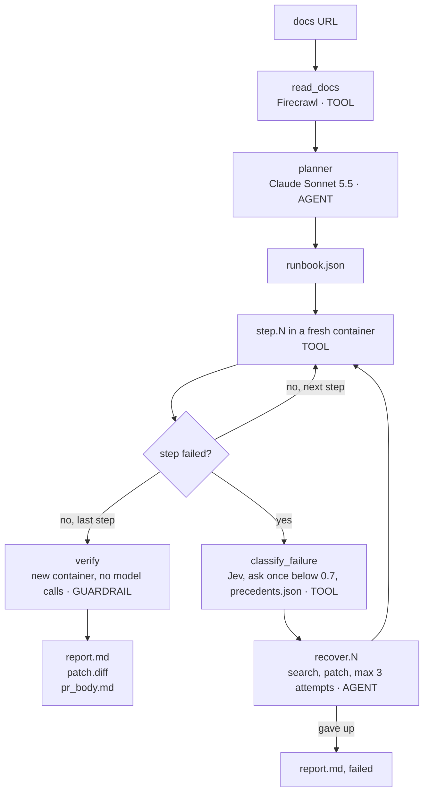

# FirstRun

FirstRun runs your quickstart in a clean container, finds the first step that breaks, and proves the fix with a second clean run.

```bash
firstrun https://docs.example.com/quickstart
```

Site: https://1run.netlify.app

<!-- FILL:demo_gif -->

- **neatlogs** records one trace per run. Every step, model call and recovery is a span you can open.
- **Entire** records the build. Every commit carries a checkpoint, and the build agents read the repo through Graph.
- **cfo.ai** models what a nightly docs check costs and earns. <!-- FILL:cfo -->

## A Broken Quickstart Gets Fixed and Verified in 195 Seconds

The input below is a known-broken test fixture (`tests/fixtures/docs/broken_quickstart_FIXTURE.md`), not a real project's docs. Step 3 pins an old chromadb that cannot install on Python 3.11.

```text
Step 3 of 4: pip install chromadb==0.3
ERROR: No matching distribution found for numpy~=1.21.6

Cause:    docs_bug (source: jev)
Patch:    step 3 -> pip install chromadb
Verified: 4/4 steps passed in a fresh container
Time to first success: 195 s
```

FirstRun writes `report.md`, `patch.diff` and `pr_body.md` into the run folder. The patch is one line.

## Run Your First Check in 5 Minutes

You need:

- Python 3.11 or newer.
- Docker. On Windows, run Docker inside WSL with the `Ubuntu-22.04` distro.
- A Claude subscription token in `CLAUDE_CODE_OAUTH_TOKEN`. Create one with `claude setup-token`.
- Optional: `NEATLOGS_API_KEY` for traces.
- Optional: `TYPESAFE_API_KEY` for Jev. Without it, Claude classifies the failure.

Install:

```bash
pip install git+https://github.com/HighnessAtharva/firstrun
```

FirstRun reads keys from `.env` in the folder you run it from. To use another file, set `FIRSTRUN_ENV_FILE`:

```bash
export FIRSTRUN_ENV_FILE=/path/to/your/.env
```

On Windows with Docker in WSL, FirstRun calls `wsl -d Ubuntu-22.04 docker`. On Linux or macOS, set `FIRSTRUN_DOCKER=docker`.

Run it on a quickstart URL:

```bash
firstrun https://docs.example.com/quickstart
```

A URL tested in the last 24 hours returns the cached result. Add --fresh to run it again.

Read the result in `runs/<run-id>/report.md`. Build the HTML report with:

```bash
firstrun report --html
```

The offline test suite needs no network, Docker or keys:

```bash
pytest -q
```

## One Trace Follows the Docs Page From Read to Verified Fix



A `budget` GUARDRAIL span runs before every recovery. The root span `firstrun.run` is a WORKFLOW span that holds the whole tree. [docs/architecture.md](docs/architecture.md) lists the states, the failure classes, the budgets and every span.

## Each of the 8 Focus Areas Has a Feature You Can Open

| Focus area | Feature | Where you see it |
|---|---|---|
| Planning | The planner turns the docs page into a runbook | `runbook.json`, the `planner` span |
| Tool use | Firecrawl reads, Docker runs, Jev classifies | One TOOL span per call |
| State | `state.json` is written after every step | `firstrun run --resume RUN_ID` |
| Context | The planner reads only the quickstart page | `read_docs` span input |
| Execution | One fresh container per run | `step.N` spans with exit codes |
| Recovery | Classify, search, patch, retry up to 3 times | `recover.N` span |
| Verification | A model-free re-run in a new container | `verify` span, status `verified` |
| Iteration | v1 traces, detections, a fix, v2 traces | The results table below |

## The Three Tools Each Do One Job

### neatlogs Shows What the Agent Did

Each run is one `firstrun.run` trace. Span kinds are WORKFLOW, AGENT, TOOL and GUARDRAIL, as the diagram shows. Claude calls appear as typed LLM spans.

Two detections run on the traces: "docs step broke" and "planner invented a step". The second one flagged 3 planner spans in v1. Investigate traced them to the planner prompt and proposed a stricter one ([evidence/neatlogs-investigation.md](evidence/neatlogs-investigation.md)). A Claude Code session read the detection and its trend over the neatlogs MCP server and applied the fix in commit 3ca6f11, with code guards that drop invented, placeholder and fake-secret steps.

The integration check read 3 real runs back from persisted traces. See [docs/neatlogs-integration.md](docs/neatlogs-integration.md).

### Entire Records How the Build Happened

- **Checkpoints:** every commit carries an `Entire-Checkpoint:` trailer. The neatlogs fix commit shows the full agent session behind it: [checkpoint 01M4JGJ6NTE7YNB9Z0YW5FYVHN](https://entire.io/gh/HighnessAtharva/firstrun/commit/3ca6f118ecb0a8915315eea27b5588dd8a7c6299).
- **Trail reviews:** Entire runners reviewed every layer on Trails 3 to 7. They raised 2 real bugs on Layer 1, a secret retry loop and a Windows-only Docker default, both fixed in e2aacb7.
- **Trails:** [Trail 1](https://entire.io/gh/HighnessAtharva/firstrun/trails/1) covers Layer 1.
- **Graph:** the build agents searched the repo through the graph. 4 graph calls saved about 11,662 tokens.
- **Brain:** it holds 7 durable facts, such as why recovery stops at 3 attempts. Its last refresh indexed 63 files and 1,056 symbols.

### cfo.ai Prices the Nightly Check

<!-- FILL:cfo -->

## Version 2 Finishes 3 of 4 Quickstarts and Recovers 3 Failed Steps

v1 ran with recovery off. v2 ran after the neatlogs planner fix (3ca6f11), with recovery and verification on. The same four targets ran both times. Cost and duration come from the neatlogs traces in [evidence/before_after_traces.json](evidence/before_after_traces.json). Cost is the Sonnet 5.5 list price and is not billed, because the runs use a subscription token.

| Target | v1 (recovery off) | v2 (neatlogs fix, recovery, verify) |
|---|---|---|
| neatlogs Python SDK | passed 3/3 | passed 3/3 |
| Entire CLI install | failed at step 1, `curl: command not found` | verified 4/4 after 2 fixes, one of them a real docs fix |
| Chroma getting started | passed 3/3 | passed 2/2 |
| OpenAI v0 README (fixture, Wayback 2023-08-02) | failed at step 6, `openai: command not found` | pinned `openai==0.28.1`, then stopped honestly: the example needs an OpenAI key |

| Metric | v1 | v2 |
|---|---|---|
| Quickstarts that end passed or verified | 2 of 4 | 3 of 4 |
| Failed steps recovered | 0 | 3 |
| Fixes proven in a fresh container | 0 | 1 |
| Average tool spans per run | 4.25 | 6.0 |
| Average cost per run, from neatlogs | $0.0262 | $0.0200 |
| Average run time, verification included | 128 s | 201 s |

v2 takes longer because a verified fix runs the whole quickstart a second time in a new container.

The six mistakes the agent made in v1:

1. The plan changes between runs. The same neatlogs page gave 4 steps, then 3 steps, 5 minutes later.
2. The planner invents steps. It added `command -v entire` and `test -f first_trace.py`, which the docs never say.
3. The planner writes placeholder steps. Chroma step 2 is `true`.
4. A fake secret passes as a step. `export OPENAI_API_KEY='sk-...'` exits 0.
5. The planner skips the steps that matter, because they need a key.
6. 9 of 16 steps check only the exit code.

## FirstRun Found 3 Real Docs Bugs and Opened 3 Upstream PRs

FirstRun ran five open-source quickstarts whose docs live in public repos. Every finding below came from a verified run, where a second clean container passed with the fix.

| Quickstart | Result | What FirstRun found | Upstream |
|---|---|---|---|
| [dbt Core with DuckDB](https://docs.getdbt.com/guides/duckdb) | verified 9/10 | `jafgen --years 6` fails because `years` is now positional | [dbt-labs/docs.getdbt.com#10149](https://github.com/dbt-labs/docs.getdbt.com/pull/10149) |
| same guide | verified | the cloned repo pins `networkx==3.7`, which needs Python 3.12, and the guide names no version | [dbt-labs/docs.getdbt.com#10150](https://github.com/dbt-labs/docs.getdbt.com/pull/10150) |
| [Entire CLI install](https://docs.entire.io/installation) | verified 4/4 | `install.sh` puts `entire` in `~/.local/bin`, which a clean shell lacks on `PATH` | [entireio/cli#2724](https://github.com/entireio/cli/pull/2724) |
| [AccuKnox knoxctl](https://help.accuknox.com/knoxctl/) | verified 5/5 | the docs commands work, the container needed `curl` and `gnupg` | none needed |
| [MkDocs getting started](https://www.mkdocs.org/getting-started/) | verified 9/10 | the docs commands work, the container needed `curl` | none needed |
| [Dagster quickstart](https://docs.dagster.io/getting-started/quickstart) | verified 10/10 | the docs already cover both gaps FirstRun hit: install `create-dagster` first, and pip 25.1 for `--group` | none needed |

Replay any of them in the browser at [1run.netlify.app](https://1run.netlify.app).

## What Broke While Building

- **Git 2.33 hung Entire checkpoints.** The post-commit hook waited 206 s on `git update-ref --stdin`, and the checkpoint was never written. Git 2.55.0 fixed it, and the next hook took 3 s.
- **One run split into 3 traces.** The first live run on the neatlogs docs produced 3 traces. The CLI now opens one `firstrun.run` trace around reading, planning, every step and verification.
- **Ask-once crashed background runs.** The prompt raised `EOFError` with no terminal. It now returns nothing, and recovery uses the top class.
- **Tests exported junk traces.** Each `pytest` run created about 50 empty `neatlogs-app` traces. The test fixture now sets an empty key, and a run after the fix created 0 traces.
- **A docs note looked like a docs bug.** On Dagster, FirstRun labeled two gaps as docs bugs. A check of the source showed the page already covers both, in a prerequisite line and a note the planner skipped. FirstRun now opens no PR on Dagster. Every PR draft gets a source check before it ships.
- **A cd broke steps three ways.** A leading cd, a cd inside a patched chain, and a file check after cd each failed a step that worked. The container now treats a cd into the folder it is already in as a no-op, and file checks also look from the run root.
- **The Entire Brain watcher does not run on Windows.** Brain runs with `--no-daemon` and is refreshed by hand.

## Known Limits Are Listed With the Edge Case That Found Them

[docs/known-limits.md](docs/known-limits.md) lists what FirstRun does not do yet. Examples: a hung step is not retried, and version pinning covers pip only.

## Parallel Agents Built It and Entire Reviewed Every Layer

- **Build:** a lead session planned the work and ran worker agents in parallel, one track each: fixtures, planner, executor, recovery, verification, report page, then edge cases. All agents ran on Sonnet 5.5 at medium effort.
- **Review:** each layer is an Entire Trail, so Entire runners reviewed every commit since kickoff. They found 3 real bugs, all fixed: a secret retry loop, a Windows-only Docker default, and a cd guard that was written but never called.
- **CI:** GitHub Actions runs the 246 offline tests on every push and pull request.
- **Jury self-test:** the Entire judge plugin, run on this repo with the real start time, ranked it with no excluded work: 3.93 of 5, authenticity 4.5, integrity 5.0. The report is [evidence/jury-selftest.txt](evidence/jury-selftest.txt).

Planning happened before the event in a private repo. No FirstRun code existed before kickoff on 2026-10-10 at 12:30 PM IST. The build log is [hackathon.md](hackathon.md).
