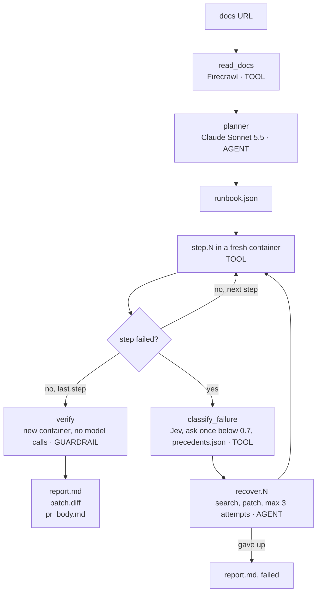

<div align="center">


# FirstRun

### Docs that work. Literally.

FirstRun runs your quickstart in a clean container, finds the first step that breaks, and proves the fix with a second clean run.

[](https://firstrun.atharvashah.com/)
[](https://neatlogs.com/hackathon)
[](.github)
[](pyproject.toml)

[**Try it in the browser**](https://firstrun.atharvashah.com/) · [**Watch a real run**](https://firstrun.atharvashah.com/run.html) · [**See the 4 upstream PRs**](#firstrun-found-4-real-docs-bugs-and-opened-4-upstream-prs) · [**Follow the build on X**](https://x.com/cultist_dev)

<br>

<video src="docs/assets/firstrun-launch.mp4" poster="docs/assets/launch-poster.jpg" width="860" muted loop playsinline controls>

</video>

<sub>The 44-second launch film. The video does not play for you? [Open it on the site](https://firstrun.atharvashah.com/) or [download the MP4](docs/assets/firstrun-launch.mp4).</sub>

</div>

<br>

```bash
pip install git+https://github.com/HighnessAtharva/firstrun
firstrun https://docs.example.com/quickstart
```

## Break, Fix, Prove Takes 195 Seconds

<div align="center">

</div>

<table>
<tr>
<td width="33%" valign="top"><br><b>1. Read</b><br>FirstRun reads the page and plans one step per command.</td>
<td width="33%" valign="top"><br><b>2. Run</b><br>Every step runs in a clean container, like a new developer. The first failure stops the run.</td>
<td width="33%" valign="top"><br><b>3. Prove</b><br>A fix is done only when a second clean container passes the whole quickstart.</td>
</tr>
</table>

The input below is a known-broken test fixture (`tests/fixtures/docs/broken_quickstart_FIXTURE.md`), not a real project's docs. Step 3 pins an old chromadb that cannot install on Python 3.11.

```text
Step 3 of 4: pip install chromadb==0.3
ERROR: No matching distribution found for numpy~=1.21.6

Cause:    docs_bug (source: jev)
Patch:    step 3 -> pip install chromadb
Verified: 4/4 steps passed in a fresh container
Time to first success: 195 s
```

FirstRun writes `report.md`, `patch.diff` and `pr_body.md` into the run folder. The patch is one line.

## Seven Teams Get a Different Job Out of the Same Engine

| # | You are | The problem | Run this | You get |
|---|---|---|---|---|
| **1** | A DevRel or docs lead | Nobody tests the quickstart after launch day | `firstrun <url>` | A pass or a verified fix, with a PR draft |
| **2** | A release manager | A new release of your package broke the docs and you do not know which one | `firstrun bisect <run> --package <pkg>` | The last good and first bad release |
| **3** | A technical writer | The docs assume tools the reader does not have | `firstrun prereqs <run>` | A Prerequisites block, proven in a clean container |
| **4** | An open-source contributor | You want a first PR that a maintainer merges | `firstrun pr <run>` | The `gh` commands for the docs PR, source check included |
| **5** | An engineer picking a tool | You want to know if the vendor's quickstart works before you commit | `firstrun <url>` | A time to first success and the first step that breaks |
| **6** | A coding agent | You need a loop that checks its own docs work | `firstrun run --resume <id>` | State after every step and a model-free verify |
| **7** | A head of docs | Hundreds of pages, and the code moved under some of them | `firstrun audit owner/repo` | Stale pages with the commits behind them, features with no docs, proposal cards and drafted release notes |

<details open>
<summary><b>7. Which docs did the product outgrow?</b> Audit the whole docs set from the git history.</summary>

```bash
firstrun audit fastapi/typer
```

```bash
firstrun audit dbt-labs/dbt-core --docs-repo dbt-labs/docs.getdbt.com
```

One blobless clone gives the whole history. The audit then works offline and costs $0 in model calls. Jev sorts commits with no conventional prefix when `TYPESAFE_API_KEY` is set, and every audit is one neatlogs trace.

- **Oldest first.** Every page, ranked by the date of its last edit.
- **Stale or quiet.** A page is stale when product commits on its topic landed after its last edit, and the report names those commits. An old page that nothing changed under is quiet, so the team can leave it alone.
- **Features with no docs.** Each user-facing commit in 120 days is checked against the docs text. A flag or name that no page mentions becomes a "Document this" card.
- **Proposal cards.** Document this, refresh this page, feature this, create content around a feature with 3 or more commits, and automate the release notes.
- **Drafts.** Release notes for the newest stable tag and up to 3 product highlights, written from commit subjects and pull request numbers.

`firstrun audit-issue` turns the newest audit into `issue.md`, one checkbox per card, and prints the `gh issue create` command. It opens nothing on its own.

To audit every week, copy [`examples/github-action/firstrun-audit.yml`](examples/github-action/firstrun-audit.yml) into `.github/workflows/`. Each Monday it audits the repo and updates one issue labeled `firstrun-audit`, so the docs team gets a fresh work list without anyone running a command.

`--docs-repo` reads the docs from a second repo when the docs site lives apart from the code. Inside this repo, each audit is published to `docs/audits/` and opens at [audit.html](https://1run.netlify.app/audit.html).

</details>

<details open>
<summary><b>1. Does my quickstart work today?</b> Run it every night.</summary>

<br>

A DevRel team ships a quickstart once and a dependency moves the week after. The first person to find the break is a new user, and most new users leave instead of filing a bug.

```bash
firstrun https://docs.example.com/quickstart
```

A clean pass ends as `passed`. A break ends as `verified` once a second container proves the fix. The nightly check costs $0.0167 per run on average over 64 runs, measured by neatlogs at list price.

</details>

<details>
<summary><b>2. Which release broke it, and when?</b> Docs Bisect names the package version.</summary>

<br>

```bash
firstrun bisect <run> --package jafgen
```

FirstRun binary-searches the package's releases, one fresh container per probe, with the version pinned through `PIP_CONSTRAINT`. It replays stored commands, so a bisect makes no model calls.

**Real result:** the dbt DuckDB guide never worked in a clean environment. Its step `jafgen --years 6` passes on jafgen 0.3.1 (2023-01-17) and fails on 0.4.6 (2024-04-07). PyPI has no release between them. The guide merged on 2025-03-14, 11 months after `--years` was gone. 5 probes found it.


</details>

<details>
<summary><b>3. What does it silently assume?</b> Prerequisite Proof writes the missing block.</summary>

<br>

```bash
firstrun prereqs <run>
```

FirstRun turns the container fixes of a run into a Prerequisites block. Then it proves the block. A fresh container with only those items runs the docs as written.

| Quickstart | The docs assume | Proof in a clean `python:3.11-slim` |
|---|---|---|
| AccuKnox knoxctl | curl, ca-certificates, gnupg, sudo | proven, 5/5 steps |
| MkDocs | curl | proven, 9/9 steps |
| Entire install | curl, git, `~/.local/bin` on `PATH` | proven, 4/4 steps, git found in round 2 |
| dbt + DuckDB | Python 3.12 or later, git | steps 1 to 9 pass on `python:3.12-slim`, step 10 is the jafgen docs bug |

</details>

<details>
<summary><b>4. Open the docs PR.</b> A verified fix becomes an upstream pull request.</summary>

<br>

```bash
firstrun pr <run>
```

FirstRun prints the `gh` commands and a PR body. Every draft gets a source check first, because a docs note can look like a docs bug. FirstRun opened 4 real PRs this way. They are listed [below](#firstrun-found-4-real-docs-bugs-and-opened-4-upstream-prs).

</details>

<details>
<summary><b>5. Test a vendor before you adopt it.</b> Time to first success is the number.</summary>

<br>

Point FirstRun at any public quickstart. The report shows how long a new developer needs to reach a working result, and where they get stuck first.

</details>

<details>
<summary><b>6. Give your coding agent the loop.</b> Plan, run, recover, verify, with a trace.</summary>

<br>

The site hands you a prompt for Claude Code, Cursor or Codex. The agent installs FirstRun, checks Docker, runs your quickstart, proves the fix and opens the PR when you say yes. `state.json` is written after every step, so a run resumes with `firstrun run --resume RUN_ID`.

</details>

## Radar Picks the Quickstarts Worth a Run, and the Run Log Picks the Buyers

FirstRun spends model money on every run, so it should only run where a break is likely and someone will read the fix.

1. **Find.** Exa search returns candidate quickstart pages at no cost.
2. **Rank.** `scripts/radar.py` asks Jev 4 typed questions per page in one call: can it run unattended in a container, is a step likely to break, how many developers read it, and is it the official docs. Code multiplies the answers into one priority. No model reads the pages one by one.
3. **Run.** `firstrun run --targets targets-radar.txt --tag radar --tier team` runs the top pages in 3 parallel lanes under the plan-set cost cap. Every run is logged on the [runs page](https://1run.netlify.app/runs/).
4. **Sell.** `scripts/buyers.py` maps each docs site FirstRun ran on or audited to its company, enriches it through treg at $0.0018 a lookup, and asks Jev whether the company fits the $49 to $299 plan. The result is [business/buyers.md](business/buyers.md): companies FirstRun already has proof for, each linked to its replay. It holds company data only, with no people and no emails.

```bash
python scripts/radar.py --from-exa exa_results/*.txt --top 20
```

```bash
python scripts/buyers.py
```

## FirstRun Found 4 Real Docs Bugs and Opened 4 Upstream PRs

FirstRun ran five open-source quickstarts whose docs live in public repos. Every finding came from a verified run, where a second clean container passed with the fix.

<table>
<tr>
<td width="33%" valign="top"><a href="https://github.com/dbt-labs/docs.getdbt.com/pull/10149"></a><br><b>dbt-labs/docs.getdbt.com#10149</b><br>Fix the jafgen command in the DuckDB quickstart.</td>
<td width="33%" valign="top"><a href="https://github.com/dbt-labs/docs.getdbt.com/pull/10150"></a><br><b>dbt-labs/docs.getdbt.com#10150</b><br>State the Python version the DuckDB quickstart needs.</td>
<td width="33%" valign="top"><a href="https://github.com/entireio/cli/pull/2724"></a><br><b>entireio/cli#2724</b><br>Say where install.sh puts entire on Linux.</td>
</tr>
</table>

| Quickstart | Result | What FirstRun found | Upstream |
|---|---|---|---|
| [dbt Core with DuckDB](https://docs.getdbt.com/guides/duckdb) | verified 9/10 | `jafgen --years 6` fails because `years` is now positional | [dbt-labs/docs.getdbt.com#10149](https://github.com/dbt-labs/docs.getdbt.com/pull/10149) |
| same guide | verified | the cloned repo pins `networkx==3.7`, which needs Python 3.12, and the guide names no version | [dbt-labs/docs.getdbt.com#10150](https://github.com/dbt-labs/docs.getdbt.com/pull/10150) |
| [Entire CLI install](https://docs.entire.io/installation) | verified 4/4 | `install.sh` puts `entire` in `~/.local/bin`, which a clean shell lacks on `PATH` | [entireio/cli#2724](https://github.com/entireio/cli/pull/2724) |
| [AccuKnox knoxctl](https://help.accuknox.com/knoxctl/) | verified 5/5 | the page names 0.9.0 as latest while the installer fetches 0.9.58, and the APT steps need `curl`, `gnupg` and `sudo` | [accuknox/help#671](https://github.com/accuknox/help/pull/671) |
| [MkDocs getting started](https://www.mkdocs.org/getting-started/) | verified 9/10 | the docs commands work, the container needed `curl` | none needed |
| [Dagster quickstart](https://docs.dagster.io/getting-started/quickstart) | verified 10/10 | the docs already cover both gaps FirstRun hit: install `create-dagster` first, and pip 25.1 for `--group` | none needed |

On #10149, a bisect comment shows jafgen 0.4.6 dropped `--years` 11 months before the guide shipped. Replay any run in the browser at [firstrun.atharvashah.com](https://firstrun.atharvashah.com/run.html).

## Built for #neatHack With Three Required Tools

<div align="center">

[](https://neatlogs.com/hackathon)

**A huge thanks to the [neatlogs](https://neatlogs.com) team for #neatHack.**
One weekend, one solo build, and three tools that each did one job.
No FirstRun code existed before kickoff on 2026-10-10 at 12:30 PM IST.

</div>

<table>
<tr>
<td width="33%" valign="top" align="center">
<a href="https://neatlogs.com"></a>
<h3>neatlogs</h3>
<b>Traces every run.</b><br>
The planner, executor and verifier show up as spans, so a bad run has a cause you can read.
</td>
<td width="33%" valign="top" align="center">
<a href="https://entire.io"></a>
<h3>Entire</h3>
<b>Records every session.</b><br>
Each commit carries the Claude Code session that wrote it, so any line traces to a prompt.
</td>
<td width="33%" valign="top" align="center">
<a href="https://cfo.ai"></a>
<h3>cfo.ai</h3>
<b>Turns cost into a plan.</b><br>
The measured cost per run from neatlogs goes into the pricing model.
</td>
</tr>
</table>

### neatlogs Shows What the Agent Did

Each run is one `firstrun.run` trace. The span kinds are WORKFLOW, AGENT, TOOL and GUARDRAIL. Claude calls appear as typed LLM spans.

<table>
<tr>
<td width="50%" valign="top"><br><b>One trace per run.</b> Reading, planning, every step and verification sit under one root span.</td>
<td width="50%" valign="top"><br><b>A custom detection.</b> "Docs step broke" flags failed tool spans. 40 flagged.</td>
</tr>
<tr>
<td width="50%" valign="top"><br><b>Detection analysis.</b> 132 traces, 154 errors. "Docs step broke" hit 35 times, 12.9%.</td>
<td width="50%" valign="top"><br><b>Investigate.</b> A 52.8x spike in Execution Failed opened a root cause with a confidence score.</td>
</tr>
<tr>
<td width="50%" valign="top"><br><b>Recovery spans.</b> Classify, search, patch and retry show as `recover.N` spans.</td>
<td width="50%" valign="top"><br><b>Analytics.</b> 132 traces and $0.9071 total cost, in one view.</td>
</tr>
</table>

Two detections run on the traces: "docs step broke" and "planner invented a step". The second one flagged 3 planner spans in v1. Investigate traced them to the planner prompt and proposed a stricter one ([evidence/neatlogs-investigation.md](evidence/neatlogs-investigation.md)). A Claude Code session read the detection and its trend over the neatlogs MCP server and applied the fix in commit 3ca6f11. The fix adds code guards that drop invented, placeholder and fake-secret steps.

The integration check read 3 real runs back from persisted traces. See [docs/neatlogs-integration.md](docs/neatlogs-integration.md).

### Entire Records How the Build Happened

<table>
<tr>
<td width="33%" valign="top"><br><b>Checkpoint on every commit.</b> Any commit maps back to the session that wrote it.</td>
<td width="33%" valign="top"><br><b>A merge gate.</b> The merge stays blocked while a high finding is open.</td>
<td width="33%" valign="top"><br><b>Inline review.</b> The finding sits on the line in <code>src/firstrun/recovery.py</code>.</td>
</tr>
</table>

- **Checkpoints:** every commit carries an `Entire-Checkpoint:` trailer. The neatlogs fix commit shows the full agent session behind it: [checkpoint 01M4JGJ6NTE7YNB9Z0YW5FYVHN](https://entire.io/gh/HighnessAtharva/firstrun/commit/3ca6f118ecb0a8915315eea27b5588dd8a7c6299).
- **Trail reviews:** Entire runners reviewed every layer on Trails 3 to 7. They raised 2 real bugs on Layer 1, a secret retry loop and a Windows-only Docker default, both fixed in e2aacb7.
- **Trails:** [Trail 1](https://entire.io/gh/HighnessAtharva/firstrun/trails/1) covers Layer 1.
- **Graph:** the build agents searched the repo through the graph. 4 graph calls saved about 11,662 tokens.
- **Brain:** it holds 7 durable facts, such as why recovery stops at 3 attempts. Its last refresh indexed 63 files and 1,056 symbols.

### cfo.ai Prices the Nightly Check

<table>
<tr>
<td width="45%" valign="top"><br><sub>Ari, the cfo.ai agent, on day one.</sub></td>
<td valign="top">

The business plan sets the agent's spending limit. `firstrun econ` reads 64 neatlogs traces and writes [business/drivers.csv](business/drivers.csv) for cfo.ai. The mean run costs $0.0167, and the p95 run costs $0.0508. A 70% margin floor turns those costs into a cap per tier, and `firstrun run --tier scale` stops any run that spends past the cap.

| Tier | Price | Quickstarts | Cap per run | Runs over the cap |
|---|---|---|---|---|
| Free | $0 | 1, weekly | $0.0108 | 48.4% |
| Team | $49 a month | 10, nightly | $0.0471 | 7.8% |
| Scale | $299 a month | 100, nightly, with PRs, Bisect and Prerequisite Proof | $0.0280 | 25.0% |

The old fixed cap of $0.50 let one bad month cost a Scale customer's fee five times over. The plan, the Scale fix and every assumption are in [business/BUSINESS_PLAN.md](business/BUSINESS_PLAN.md). The cfo.ai model is public at [https://cfo.ai/s/_u5lbrHIl9KX_JQE](https://cfo.ai/s/_u5lbrHIl9KX_JQE). Under the old cap, cash goes negative in month 14.

</td>
</tr>
</table>

## The Build Happened in Public on X

Every step is a post on [@cultist_dev](https://x.com/cultist_dev). The five below tell the story in order.

<table>
<tr>
<td width="50%" valign="top">

**kickoff**<br>
> #neatHack kickoff, 12:30 IST. FirstRun code before kickoff: 0 lines. neatlogs doctor probe: 7/7 PASS. Solo build. Submission opens Monday, 7 PM IST.

[Read on X](https://twitter.com/cultist_dev/status/2108815318541844954)

</td>
<td width="50%" valign="top">

**day one**<br>
> #neatHack, day one. all three required tools are up. Entire: trail #1 created. neatlogs: first agent trace, 3 steps, 12s. cfo.ai: Ari read my public profile.

[Read on X](https://twitter.com/cultist_dev/status/2108826005854937357)

</td>
</tr>
<tr>
<td width="50%" valign="top">

**the pitch**<br>
> your quickstart is the only part of your product tested by people who leave instead of filing a bug. so for #neatHack i'm building FirstRun. break. fix. prove.

[Watch on X](https://twitter.com/cultist_dev/status/2108828983194206308)

</td>
<td width="50%" valign="top">

**the plan**<br>
> a quickstart breaks the way an agent breaks. quietly. so the plan for this weekend: every FirstRun run becomes a trace in @neatlogs.

[Read on X](https://twitter.com/cultist_dev/status/2108856505566921210)

</td>
</tr>
<tr>
<td colspan="2" valign="top">

**the first catch**<br>
> my neatlogs hackathon project has already caught doc issues for a chroma (24K+ github stars). chromadb's deprecated-config error sends you to its own migration guide. that page returns 404.

[Read on X](https://twitter.com/cultist_dev/status/2108788557670125946)

</td>
</tr>
</table>

## Run Your First Check in 5 Minutes

You need:

- Python 3.11 or newer.
- Git. `pip install git+https://...` clones the repo, so it fails without git.
- Docker. On Windows, run Docker inside WSL with the `Ubuntu-22.04` distro.
- A Claude subscription token in `CLAUDE_CODE_OAUTH_TOKEN`. Create one with `claude setup-token`.
- Optional: `NEATLOGS_API_KEY` for traces.
- Optional: `TYPESAFE_API_KEY` for Jev. Without it, Claude classifies the failure.

Install:

```bash
pip install git+https://github.com/HighnessAtharva/firstrun
```

FirstRun reads keys from `.env` in the folder you run it from. To use another file, set `FIRSTRUN_ENV_FILE`:

```bash
export FIRSTRUN_ENV_FILE=/path/to/your/.env
```

FirstRun uses `docker` from your `PATH`. On Windows without it, FirstRun calls Docker inside WSL with `wsl -d Ubuntu-22.04 docker`. Set `FIRSTRUN_DOCKER` to use another command.

Run it on a quickstart URL:

```bash
firstrun https://docs.example.com/quickstart
```

A URL tested in the last 24 hours returns the cached result. Add `--fresh` to run it again.

Read the result in `runs/<run-id>/report.md`. Build the HTML report with:

```bash
firstrun report --html
```

Run it inside a clone of this repo and every run is logged for the public site. FirstRun writes the replay to `docs/runs/` and adds a row to `docs/runs/index.json`. Commit those files and the run appears on the [runs page](https://1run.netlify.app/runs/). Rebuild the log from the `runs/` folder with:

```bash
firstrun publish --all
```

The offline test suite needs no network, Docker or keys. The tests ship with the repo, not with the pip package, so clone it first:

```bash
git clone https://github.com/HighnessAtharva/firstrun
```

```bash
cd firstrun && pip install -e ".[dev]" && pytest -q
```

FirstRun ran this section on itself in a clean `python:3.11-slim` container. The install failed until git was present, which is why git is listed above. The run step then stopped with the missing-token message, because a clean container has no Claude token or Docker.

## One Trace Follows the Docs Page From Read to Verified Fix



A `budget` GUARDRAIL span runs before every recovery. The root span `firstrun.run` is a WORKFLOW span that holds the whole tree. [docs/architecture.md](docs/architecture.md) lists the states, the failure classes, the budgets and every span.

## Each of the 8 Focus Areas Has a Feature You Can Open

| Focus area | Feature | Where you see it |
|---|---|---|
| Planning | The planner turns the docs page into a runbook | `runbook.json`, the `planner` span |
| Tool use | Firecrawl reads, Docker runs, Jev classifies | One TOOL span per call |
| State | `state.json` is written after every step | `firstrun run --resume RUN_ID` |
| Context | The planner reads only the quickstart page | `read_docs` span input |
| Execution | One fresh container per run | `step.N` spans with exit codes |
| Recovery | Classify, search, patch, retry up to 3 times | `recover.N` span |
| Verification | A model-free re-run in a new container | `verify` span, status `verified` |
| Iteration | v1 traces, detections, a fix, v2 traces | The results table below |

## Version 2 Finishes 3 of 4 Quickstarts and Recovers 3 Failed Steps

v1 ran with recovery off. v2 ran after the neatlogs planner fix (3ca6f11), with recovery and verification on. The same four targets ran both times. Cost and duration come from the neatlogs traces in [evidence/before_after_traces.json](evidence/before_after_traces.json). Cost is the Sonnet 5.5 list price and is not billed, because the runs use a subscription token.

| Target | v1 (recovery off) | v2 (neatlogs fix, recovery, verify) |
|---|---|---|
| neatlogs Python SDK | passed 3/3 | passed 3/3 |
| Entire CLI install | failed at step 1, `curl: command not found` | verified 4/4 after 2 fixes, one of them a real docs fix |
| Chroma getting started | passed 3/3 | passed 2/2 |
| OpenAI v0 README (fixture, Wayback 2023-08-02) | failed at step 6, `openai: command not found` | pinned `openai==0.28.1`, then stopped honestly: the example needs an OpenAI key |

| Metric | v1 | v2 |
|---|---|---|
| Quickstarts that end passed or verified | 2 of 4 | 3 of 4 |
| Failed steps recovered | 0 | 3 |
| Fixes proven in a fresh container | 0 | 1 |
| Average tool spans per run | 4.25 | 6.0 |
| Average cost per run, from neatlogs | $0.0262 | $0.0200 |
| Average run time, verification included | 128 s | 201 s |

v2 takes longer because a verified fix runs the whole quickstart a second time in a new container.

The six mistakes the agent made in v1:

1. The plan changes between runs. The same neatlogs page gave 4 steps, then 3 steps, 5 minutes later.
2. The planner invents steps. It added `command -v entire` and `test -f first_trace.py`, which the docs never say.
3. The planner writes placeholder steps. Chroma step 2 is `true`.
4. A fake secret passes as a step. `export OPENAI_API_KEY='sk-...'` exits 0.
5. The planner skips the steps that matter, because they need a key.
6. 9 of 16 steps check only the exit code.

## What Broke While Building

- **Git 2.33 hung Entire checkpoints.** The post-commit hook waited 206 s on `git update-ref --stdin`, and the checkpoint was never written. Git 2.55.0 fixed it, and the next hook took 3 s.
- **One run split into 3 traces.** The first live run on the neatlogs docs produced 3 traces. The CLI now opens one `firstrun.run` trace around reading, planning, every step and verification.
- **Ask-once crashed background runs.** The prompt raised `EOFError` with no terminal. It now returns nothing, and recovery uses the top class.
- **Tests exported junk traces.** Each `pytest` run created about 50 empty `neatlogs-app` traces. The test fixture now sets an empty key, and a run after the fix created 0 traces.
- **A docs note looked like a docs bug.** On Dagster, FirstRun labeled two gaps as docs bugs. A check of the source showed the page already covers both, in a prerequisite line and a note the planner skipped. FirstRun now opens no PR on Dagster. Every PR draft gets a source check before it ships.
- **A cd broke steps three ways.** A leading cd, a cd inside a patched chain, and a file check after cd each failed a step that worked. The container now treats a cd into the folder it is already in as a no-op, and file checks also look from the run root.
- **The Entire Brain watcher does not run on Windows.** Brain runs with `--no-daemon` and is refreshed by hand.

Known limits are listed in [docs/known-limits.md](docs/known-limits.md). Examples: a hung step is not retried, and version pinning covers pip only.

## Parallel Agents Built It and Entire Reviewed Every Layer

- **Build:** a lead session planned the work and ran worker agents in parallel, one track each: fixtures, planner, executor, recovery, verification, report page, then edge cases. All agents ran on Sonnet 5.5 at medium effort.
- **Review:** each layer is an Entire Trail, so Entire runners reviewed every commit since kickoff. They found 3 real bugs, all fixed: a secret retry loop, a Windows-only Docker default, and a cd guard that was written but never called.
- **CI:** GitHub Actions runs the 246 offline tests on every push and pull request.
- **Jury self-test:** the Entire judge plugin, run on this repo with the real start time, ranked it with no excluded work: 3.93 of 5, authenticity 4.5, integrity 5.0. The report is [evidence/jury-selftest.txt](evidence/jury-selftest.txt).

Planning happened before the event in a private repo. The build log is [hackathon.md](hackathon.md).

<div align="center">

<br>

**Made solo by [Atharva Shah](https://atharvashah.com) for [#neatHack](https://neatlogs.com/hackathon) by [neatlogs](https://neatlogs.com).**

[firstrun.atharvashah.com](https://firstrun.atharvashah.com/) · [@cultist_dev on X](https://x.com/cultist_dev) · [GitHub](https://github.com/HighnessAtharva)

</div>
