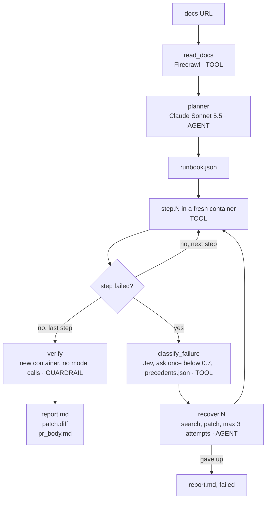

# FirstRun

FirstRun runs your quickstart in a clean container, finds the first step that breaks, and proves the fix with a second clean run.

```bash
firstrun https://docs.example.com/quickstart
```

Site: https://1run.netlify.app

<!-- FILL:demo_gif -->

- **neatlogs** records one trace per run. Every step, model call and recovery is a span you can open.
- **Entire** records the build. Every commit carries a checkpoint, and the build agents read the repo through Graph.
- **cfo.ai** models what a nightly docs check costs and earns. <!-- FILL:cfo -->

## A Broken Quickstart Gets Fixed and Verified in 195 Seconds

The input below is a known-broken test fixture (`tests/fixtures/docs/broken_quickstart_FIXTURE.md`), not a real project's docs. Step 3 pins an old chromadb that cannot install on Python 3.11.

```text
Step 3 of 4: pip install chromadb==0.3
ERROR: No matching distribution found for numpy~=1.21.6

Cause:    docs_bug (source: jev)
Patch:    step 3 -> pip install chromadb
Verified: 4/4 steps passed in a fresh container
Time to first success: 195 s
```

FirstRun writes `report.md`, `patch.diff` and `pr_body.md` into the run folder. The patch is one line.

## Run Your First Check in 5 Minutes

You need:

- Python 3.11 or newer.
- Docker. On Windows, run Docker inside WSL with the `Ubuntu-22.04` distro.
- A Claude subscription token in `CLAUDE_CODE_OAUTH_TOKEN`. Create one with `claude setup-token`.
- Optional: `NEATLOGS_API_KEY` for traces.
- Optional: `TYPESAFE_API_KEY` for Jev. Without it, Claude classifies the failure.

Install:

```bash
pip install git+https://github.com/HighnessAtharva/firstrun
```

FirstRun reads keys from `.env` in the folder you run it from. To use another file, set `FIRSTRUN_ENV_FILE`:

```bash
export FIRSTRUN_ENV_FILE=/path/to/your/.env
```

On Windows with Docker in WSL, FirstRun calls `wsl -d Ubuntu-22.04 docker`. On Linux or macOS, set `FIRSTRUN_DOCKER=docker`.

Run it on a quickstart URL:

```bash
firstrun https://docs.example.com/quickstart
```

Read the result in `runs/<run-id>/report.md`. Build the HTML report with:

```bash
firstrun report --html
```

The offline test suite needs no network, Docker or keys:

```bash
pytest -q
```

## One Trace Follows the Docs Page From Read to Verified Fix



A `budget` GUARDRAIL span runs before every recovery. The root span `firstrun.run` is a WORKFLOW span that holds the whole tree. [docs/architecture.md](docs/architecture.md) lists the states, the failure classes, the budgets and every span.

## Each of the 8 Focus Areas Has a Feature You Can Open

| Focus area | Feature | Where you see it |
|---|---|---|
| Planning | The planner turns the docs page into a runbook | `runbook.json`, the `planner` span |
| Tool use | Firecrawl reads, Docker runs, Jev classifies | One TOOL span per call |
| State | `state.json` is written after every step | `firstrun run --resume RUN_ID` |
| Context | The planner reads only the quickstart page | `read_docs` span input |
| Execution | One fresh container per run | `step.N` spans with exit codes |
| Recovery | Classify, search, patch, retry up to 3 times | `recover.N` span |
| Verification | A model-free re-run in a new container | `verify` span, status `verified` |
| Iteration | v1 traces, detections, a fix, v2 traces | The results table below |

## The Three Tools Each Do One Job

### neatlogs Shows What the Agent Did

Each run is one `firstrun.run` trace. Span kinds are WORKFLOW, AGENT, TOOL and GUARDRAIL, as the diagram shows. Claude calls appear as typed LLM spans.

Two detections run on the traces: "docs step broke" and "planner invented a step". The second one flagged 3 planner spans. Atharva used Investigate on them, and a fix went through the neatlogs MCP server. <!-- FILL:mcp_fix -->

The integration check read 3 real runs back from persisted traces. See [docs/neatlogs-integration.md](docs/neatlogs-integration.md).

### Entire Records How the Build Happened

- **Checkpoints:** every commit carries an `Entire-Checkpoint:` trailer. <!-- FILL:checkpoint_link -->
- **Trails:** [Trail 1](https://entire.io/gh/HighnessAtharva/firstrun/trails/1) covers Layer 1.
- **Graph:** the build agents searched the repo through the graph. 4 graph calls saved about 11,662 tokens.
- **Brain:** it holds 7 durable facts, such as why recovery stops at 3 attempts. Its last refresh indexed 63 files and 1,056 symbols.

### cfo.ai Prices the Nightly Check

<!-- FILL:cfo -->

## Version 1 Fails in Six Ways, and Version 2 Has to Fix Them

These are v1 runs with recovery off. Cost is the list price of Sonnet 5.5 and is not billed, because the runs use a subscription token.

| Target | v1 result | v1 time | v1 cost | v2 |
|---|---|---|---|---|
| neatlogs Python SDK | passed 3/3 | 84 s | $0.036 | <!-- FILL:v2 --> |
| Entire CLI install | failed at step 1: `curl: command not found` on python:3.11-slim | n/a | $0.023 | <!-- FILL:v2 --> |
| Chroma getting started | passed 3/3 | 250 s | $0.029 | <!-- FILL:v2 --> |
| OpenAI v0 README (fixture, Wayback 2023-08-02) | failed at step 6: `openai: command not found` | n/a | $0.031 | <!-- FILL:v2 --> |

The six mistakes the agent made in v1:

1. The plan changes between runs. The same neatlogs page gave 4 steps, then 3 steps, 5 minutes later.
2. The planner invents steps. It added `command -v entire` and `test -f first_trace.py`, which the docs never say.
3. The planner writes placeholder steps. Chroma step 2 is `true`.
4. A fake secret passes as a step. `export OPENAI_API_KEY='sk-...'` exits 0.
5. The planner skips the steps that matter, because they need a key.
6. 9 of 16 steps check only the exit code.

## What Broke While Building

- **Git 2.33 hung Entire checkpoints.** The post-commit hook waited 206 s on `git update-ref --stdin`, and the checkpoint was never written. Git 2.55.0 fixed it, and the next hook took 3 s.
- **One run split into 3 traces.** The first live run on the neatlogs docs produced 3 traces. The CLI now opens one `firstrun.run` trace around reading, planning, every step and verification.
- **Ask-once crashed background runs.** The prompt raised `EOFError` with no terminal. It now returns nothing, and recovery uses the top class.
- **Tests exported junk traces.** Each `pytest` run created about 50 empty `neatlogs-app` traces. The test fixture now sets an empty key, and a run after the fix created 0 traces.
- **The Entire Brain watcher does not run on Windows.** Brain runs with `--no-daemon` and is refreshed by hand.

## Known Limits Are Listed With the Edge Case That Found Them

[docs/known-limits.md](docs/known-limits.md) lists what FirstRun does not do yet. Examples: a hung step is not retried, and version pinning covers pip only.

## Six Worker Agents Built It in Parallel on One Branch

Six worker agents each built one track on `main`, and the lead made one commit per track. All agents ran on Sonnet 5.5.

Planning happened before the event in a private repo. No FirstRun code existed before kickoff on 2026-10-10 at 12:30 PM IST. The build log is [hackathon.md](hackathon.md).
