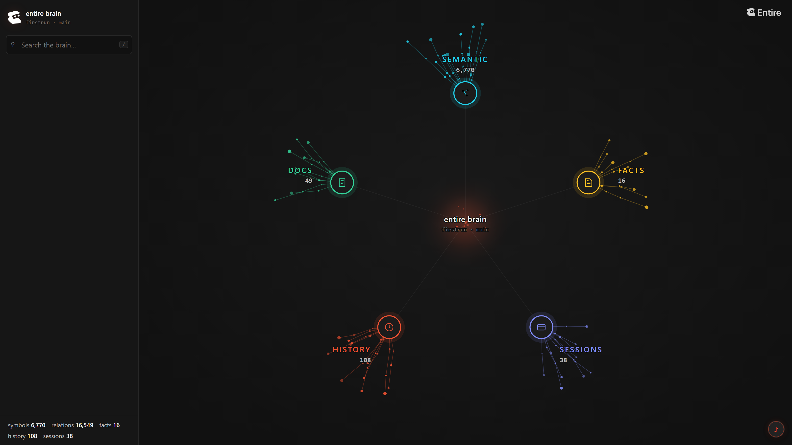

# Entire Evidence

Entire recorded the agent session behind every commit, reviewed every layer on a Trail, mapped the repo for the build agents, and kept the decisions in Brain. Numbers below were read on 2026-10-10 at about 18:45 IST.

## Every Commit Carries the Session That Wrote It

- 88 checkpoint refs are on GitHub (counted 2026-10-11, after the launch merge) under `refs/entire/checkpoints/*`. Check with `git ls-remote origin 'refs/entire/checkpoints/*'`.
- 91 of 132 non-merge commits on main up to `f5d73eb` carry an `Entire-Checkpoint:` trailer, counted with `git log --no-merges` on 2026-10-11. The 41 without are the 4 setup commits before the first agent session and site commits from 2026-10-10 and 2026-10-11. On many of those the Entire commit hook hung and was stopped so the commit could land. Merge commits carry none, because Entire's hook skips merges.
- The neatlogs fix commit shows its whole session, from the MCP calls to the green tests: [checkpoint 01M4JGJ6NTE7YNB9Z0YW5FYVHN](https://entire.io/gh/HighnessAtharva/firstrun/commit/3ca6f118ecb0a8915315eea27b5588dd8a7c6299).
- One checkpoint was lost: Git 2.33 hung the post-commit hook for 206 s on the scaffold commit. Git 2.55 fixed it, and no checkpoint was lost after that.

## Trails Reviewed Every Layer, and the Runners Found 3 Real Bugs

| Trail | Covers | Runner findings |
|---|---|---|
| [3](https://entire.io/gh/HighnessAtharva/firstrun/trails/3) | Layer 1, every commit from the scaffold to the wiring | 1 high, 1 medium, both fixed in e2aacb7 |
| [4](https://entire.io/gh/HighnessAtharva/firstrun/trails/4) | Layer 2: recovery, edge cases, the neatlogs fix | none blocking |
| [5](https://entire.io/gh/HighnessAtharva/firstrun/trails/5) | Layer 3: share codes, replay, agent launcher, cache | none blocking |
| [6](https://entire.io/gh/HighnessAtharva/firstrun/trails/6) | Real-world runs, CI | none blocking |
| [7](https://entire.io/gh/HighnessAtharva/firstrun/trails/7) | Agent hardening from real runs | 1 high, fixed in f0f1517 |
| [8](https://entire.io/gh/HighnessAtharva/firstrun/trails/8) to [12](https://entire.io/gh/HighnessAtharva/firstrun/trails/12) | Bisect, Prerequisite Proof, website, build log, README self-test | merged |

The 3 bugs the runners found:

1. **High:** a `needs_secret` step with its key already in the container retried the same command until the budget ran out.
2. **Medium:** the Docker command defaulted to the author's WSL setup, so FirstRun could not start containers on Linux or macOS.
3. **High:** the `cd` guard from d22eb69 was written and unit-tested but never called by `Container.exec`.

Each finding was resolved with `entire trail finding resolve <id> -m "fixed in <sha>"`.

## The Build Agents Searched the Repo Through the Graph

- `entire graph stats --repo .`: 10 graph calls, about 56,254 tokens saved, graph-first in 1 of 4 sessions. The first session started with grep, and the session noted it and switched.
- The full graph is in [graph.ndjson](graph.ndjson): 96 files and 1,526 symbols at the last Brain refresh.

## Brain Answers Why a Decision Was Made

`entire brain recall "why does recovery stop at 3 attempts"` returns the decision fact recorded during the build: a looping agent is the most common failure the neatlogs judges look for, so recovery stops at 3 attempts, 25 tool calls and $0.50 per run. Brain holds 7 such facts, from the Git version constraint to the one-trace-per-run rule.

**The brain covers the whole weekend since 2026-10-11.** A refresh from a clean `main` checkout raised coverage from 3 sessions to 38, and from 96 files and 1,526 symbols to 319 files, 6,770 symbols and 16,549 relations. `entire brain status` reports it healthy.

**16 facts on `main`.** The 8 new ones record weekend decisions and traps:

- cfo.ai tier caps keep a 70% margin, and every run's cost line reads them from `docs/data/plan.json`.
- A dev server step passes once its output says it listens.
- Doc-audit files issues through prefilled GitHub links, with no token and no @ mention.
- The neatlogs eval found 2 runs that classed a missing API key as `docs_bug`.
- The "docs step broke" detection counts recovered first attempts, so its 78 spans are not 78 docs bugs.
- The Entire commit hook can hang on Windows, and parallel sessions work in their own worktrees.

**Brain answers a real task.** `entire brain brief "classify a missing API key as needs_secret instead of docs_bug"` returned the 4 test files to change, the 3 tests that cover `needs_secret`, the failure-class table from the docs, and the eval fact that names the 2 misclassified runs.

**Entities link code to sessions.** `entire brain entities backfill` indexed 79 commits and 5,784 entity changes. `entire brain entities history apply_patches` traces the function to 2 commits, each with its checkpoint and session:

| Commit | Checkpoint | Change |
|---|---|---|
| `81d6403` | `01M4JBCP5ZFNH2JYXAFR6V910P` | Contracts: pydantic models and module stubs |
| `597de07` | `01M4JBN55P1TST97T7NZDX0VBF` | T5: model-free verification, docs diff, PR body |

**One gap: distill fails on Windows.** `entire brain distill --agent claude-code` stops with "The command line is too long" at every chunk size tried: 48 KB, 20 KB and 8 KB. The plugin passes its prompt to the agent as a command-line argument, and Windows caps a command line at about 32 KB. So the 16 facts were recorded by hand with `entire brain remember`, and none came from distillation.

## The Jury Self-Test Ranked the Repo With No Excluded Work

The Entire judge plugin, run on a fresh clone with the real start time, scored 3.93 of 5: authenticity 4.5, integrity 5.0, prompting 4.0, CLI awareness 4.5. The full report is [jury-selftest.txt](jury-selftest.txt). The test also found that `entire judge add` fetches only `refs/heads/entire/*`, while the default backend writes `refs/entire/checkpoints/*`. Brain's refresh fetched the refs on its own, so the repo was not dropped.
